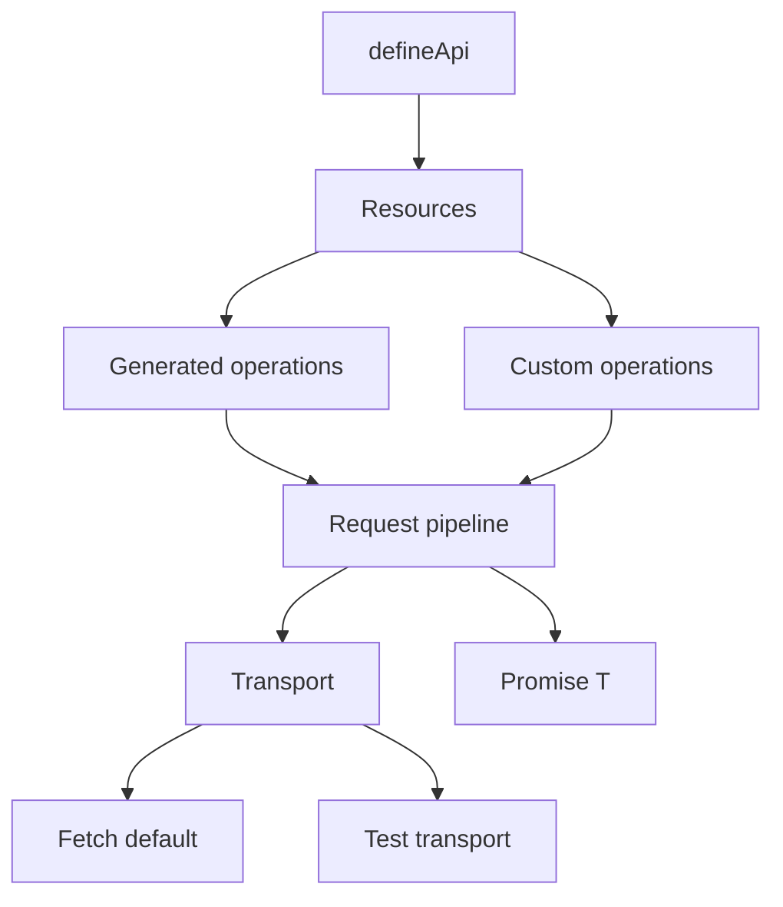

# Architecture

This document describes the architecture Apixa is building toward, and how the current codebase maps to it.

Apixa Core owns definitions, validation, and one execution lifecycle that ends in either HTTP or
the in-memory mock engine (see [ADR 003](./decisions/003-client-scoped-mocking-in-core.md)).
Mocking owns lazy dataset records and `defineMockApi()`, a thin adapter over Core's `MockStore`.
React owns the optional React integration with TanStack Query as its engine. The only npm package
is `apixa`; `src/` contains re-export entry points. Core, Mocking, React and shared helpers are
private workspace modules whose canonical source is compiled into this single distribution.
React and TanStack remain optional external peers. Core imports neither.

## High-level shape

```text
defineApi({ baseURL, headers, resources: { … } })   defineApis({ a: {…}, b: {…} })
        │
        ▼
   typed API client
        │
        ├── resource (users, posts, …)
        │       ├── generated operations (getAll, getById, create, …)
        │       └── custom operations (explicit endpoints)
        │
        ▼
   request pipeline
        │
        ├── URL / path / query construction
        ├── headers + body serialization
        ├── Transport.request(...)
        └── parse / errors → Promise<T>
```



## Design rules

1. **Single source of truth** — resources and operations are defined once.
2. **Type inference first** — argument, body, and response types come from definitions.
3. **Runtime config is authoritative** — resources live under `resources`; generic metadata supplies types only and never creates a resource or operation. Built-in CRUD exists for a resource with `path`; optional `operations` merges overrides; custom/explicit settings win.
4. **Native promises** — no custom Promise wrappers in Core.
5. **Framework-agnostic** — Core must not depend on React, Next.js, or TanStack Query.
6. **Transport-backed** — HTTP runs through a `Transport` interface; Fetch is the default implementation and stays **inside Core** until a package split is justified.
7. **Operations are add / remove / override, by name** — all 16 builtins are enabled by default. `defaultOperations`, read/write flags, groups, and individual entries resolve once at client construction. Each builtin has its own resolved request definition; custom functions use the shared `ctx.request()` pipeline. Runtime config controls the client shape and paths, while generic metadata controls payload types (see [conventions.md](./conventions.md#operation-customization)).

See also:

- [001-framework-agnostic-core.md](./decisions/001-framework-agnostic-core.md)
- [002-transport-abstraction.md](./decisions/002-transport-abstraction.md)
- [003-client-scoped-mocking-in-core.md](./decisions/003-client-scoped-mocking-in-core.md)

## Request flow

`defineApi()` and `defineApis()` share one engine (`api/client.ts`). Construction validates
everything, resolves each operation once (selection, defaults, layers, transforms, retry
policy) and returns a frozen client. It makes no network calls and loads no datasets.

Every call then runs through `request/pipeline.ts`:

1. Use the effective config pre-resolved on the operation. Precedence is root < resource <
   operation < request.
2. Resolve dynamic headers. Static, sync, and async providers run once per logical call and
   merge case-insensitively.
3. Run request middleware (root → resource → operation; `middleware.onRequest` before
   `requestMiddleware[]`).
4. Apply request key transforms. Query keys convert when the URL is built; body keys convert
   at serialization. Values are never rewritten, so `File` / `Blob` pass through untouched.
5. For HTTP only, check the final URL against the API origin after middleware. Any other
   origin is a `SecurityError`, and nothing is sent.
6. Execute. For HTTP, transport attempts run with retry, exponential backoff with jitter, and
   `Retry-After`. Middleware does not re-run on retries. For a mocked resource, the resolved
   builtin runs against its `MockStore`, or `ctx.request()` is routed by method and relative
   path. No transport is involved. Writes carrying `File` / `Blob` values first move them into
   the client's virtual file store (see "File handling"); records keep string references.
7. Apply response key transforms and operation shaping (`exists`, `getMany`, `findFirst`,
   `slice`).
8. Run response middleware.
9. Return the data, or the `ApiResponse` envelope when `{ full: true }` is passed.

One controller per call combines the overall timeout and the caller's signal. A timeout covers
retries and backoff, and is reported as `TimeoutError`, never as `AbortError`. On failure, error
middleware runs (root → resource → operation). A handler that throws replaces the error; one
that returns a value other than `undefined` recovers the call.

## React peer guard (v1.1.0, implemented)

`@tanstack/react-query` is an optional peer of the single package. An unresolved import is an
error type that behaves as `any`, and `any & X` is `any`, so hook results built on TanStack's
`UseQueryResult` would silently lose every type. `packages/react/src/peer.ts` probes
`unknown extends QueryClient` and every hook overload returns `RequireTanStackQuery<Result>`:
the real result when TanStack resolves, otherwise a named error interface. Verified by
`scripts/verify-type-consumers.mjs` (npm, packed tarball, outside the workspace). Limit: under
`skipLibCheck: true` TypeScript cannot report the unresolved module itself; the guard type is the
detectable failure. `ApixaProvider`, `QueryClient` and the hydration components extend/take
TanStack types and are not guarded (they need the package at runtime anyway).

## Downloads and binary responses (v1.2.0, implemented)

`responseType` already reached the Fetch transport per call; v1.2.0 completes it inside the same
operation system. A declarative operation can declare `responseType` (precedence: call option >
operation > JSON); `pipeline.ts` validates it, passes it to the transport and, for non-JSON types,
skips key transforms and JSON shaping (`fromHttp`, `slice`). `transport/read-body.ts` reads a
successful body as requested but always reads an error body by content type, and returns typed
empty values for 204/205. Types: `ResponseTypeData` plus `ApplyResponseType` (runtime literal,
beneath `defineApi<T>()` metadata) and `CallData` (per call, `ctx.request` overloads).
Metadata is the existing `ApiResponse`; `http/content-disposition.ts` is a pure parser. Mock
operations read the v1.1.0 `MockFileStorage` through a read-only `files` handle, and
`finalizeMockResponse` (`mock/files.ts`) coerces results to `responseType` and synthesizes the
content headers. No new package, transport interface or download client.

## File handling (v1.1.0, implemented)

Files travel inside the existing operations; there is no separate upload client.

**Declaring file fields.** `fileFields: ["avatar", "documents"]` or
`fileFields: { avatar: { name: "profile_image" } }` on a resource. Names are checked against the
entity (compile time) and must be `string` / `string[]` fields (nullable allowed). Reads keep
those types. Eligible writes (`create`, `update`, `patch`, `upsert`, `createMany`) accept
`File | Blob` and `readonly (File | Blob)[]` for them, preserving optionality and `null`. Explicit
body types and `dataFormat: "json"` keep the entity types; custom operations are not rewritten.
A stored `string` is not accepted as a file input — omit the key to keep the file.

**Choosing the format** (at serialization, after middleware and key transforms):

1. Caller-built `FormData` / `Blob` / string / buffers / streams are sent as is; for `FormData`
   Core removes `Content-Type` so the transport generates the boundary.
2. Plain objects and arrays: JSON by default; multipart automatically when the body contains a
   `File` / `Blob` anywhere; `dataFormat: "multipart"` always encodes.
3. `dataFormat: "json"` with binary values throws `SerializationError`. Binary values are never
   JSON-stringified. `dataFormat` exists on write operations only; `ctx.request({ dataFormat })`
   offers the same override to function operations.

**Multipart encoding** (`http/multipart.ts`):

| Value                                                           | Wire                                                              |
| --------------------------------------------------------------- | ----------------------------------------------------------------- |
| string, number, boolean, bigint                                 | text part (`String(value)`)                                       |
| `Date`                                                          | ISO-8601 text                                                     |
| `File` / `Blob`                                                 | file part; name, type, bytes kept (a bare `Blob` is `blob`)       |
| `undefined`                                                     | omitted                                                           |
| `null`                                                          | empty text part; `multipart.nulls: "omit"` drops it               |
| nested object                                                   | `parent[child]`, recursively                                      |
| array of scalars                                                | `key[]`; `multipart.arrays` → `"indices"` (`key[0]`) / `"repeat"` |
| array of objects                                                | `key[0][field]`                                                   |
| array of files                                                  | repeated `key` (or alias)                                         |
| top-level array body (`createMany`)                             | `items[0][field]`                                                 |
| `multipart.jsonFields` entry                                    | one part with `JSON.stringify(value)`                             |
| function, symbol, class instance, `FileList`, cycle, depth > 32 | `SerializationError` with the path only                           |

`fileFields[name].name` aliases a top-level part name verbatim; `multipart` (resource, overridable
per operation) holds `jsonFields`, `nulls` and `arrays`. Aliases and `jsonFields` use public field
names and follow the request key transform. Serialization runs once per logical call: the built
`FormData` is reused by every retry attempt, `ReadableStream` bodies are never retried, and the
caller's object is never mutated. Convert a `FileList` explicitly (`Array.from(input.files)`) before
passing it; Core takes native `File` values only, so form libraries such as React Hook Form work
without an adapter.

**Mock file storage** (`mock/files.ts`, `mock/files-exec.ts`). Each client has one in-memory
`MockFileStorage`. A mocked write on a resource with `fileFields` stages the files (bytes are
copied; ids are UUIDs; references look like `mock-file://<id>/<name>`), stores string references in
the record, then removes files no longer referenced (replacement, `update` dropping a field,
`delete`, `deleteMany`). Any failure removes the staged files and leaves records untouched. A
`Blob` in an undeclared or nested field is a `MockError` (`MOCK_INVALID_INPUT`). `mockFiles(api)`
(also `apixa/mocking`) lists, retrieves (`blob()` / `bytes()` / `text()` return fresh copies),
deletes and clears files; `resetMock` restores records and drops the files. No object URLs are ever
created. Custom declarative `mock` handlers receive the raw body. Disks, fixtures and lifecycle
policies are planned (phase 6), not implemented.

## Source map (`packages/core`)

| Responsibility       | Home         | Notes                                                                                |
| -------------------- | ------------ | ------------------------------------------------------------------------------------ |
| Client construction  | `api/`       | `defineApi`, `defineApis`, `resetMock`, validation, resource builder                 |
| Operation selection  | `operation/` | Builtin conventions, precedence (`expand.ts`), argument parsing                      |
| Execution lifecycle  | `request/`   | `pipeline.ts` (single lifecycle), `retry.ts`                                         |
| Mock engine          | `mock/`      | `MockStore`, data sources, executors, dataset metadata, file store                   |
| Key transforms       | `transform/` | Runtime converters (types in `types/transform.ts`)                                   |
| URL / headers / body | `http/`      | Base URL parsing, origin checks, header providers, query, JSON/multipart body        |
| Fetch transport      | `transport/` | Default transport                                                                    |
| Errors               | `errors/`    | `ApiError` + HTTP/Network/Timeout/Abort/Config/Security/Transform/Serialization/Mock |
| Types                | `types/`     | Definition, inference (runtime-authoritative), transforms, datasets                  |

## Architecture contract (v1.0.0)

Enforced by `pnpm check:architecture` (`scripts/check-architecture.mjs`, TypeScript module
resolution over every package's real import graph, plus the built output). Marked **implemented**
or **planned**. Rationale: [ADR 005](./decisions/005-single-package-distribution.md).
Export contracts: [public-api.md](./public-api.md).

| Package                  | Owns                                                                                                                                                      | May import                                                       | Status               |
| ------------------------ | --------------------------------------------------------------------------------------------------------------------------------------------------------- | ---------------------------------------------------------------- | -------------------- |
| `@apixa/core`            | Definitions, operations, request lifecycle, middleware, transforms, retry, errors, types, metadata, the `MockStore` bridge                                | nothing (no framework, no Node)                                  | implemented, private |
| `@apixa/mocking`         | `defineMockApi`, dataset catalog/loaders/modules, mock errors, `register`, Node utilities                                                                 | Core; `node:*` only from `node.ts`                               | implemented, private |
| `@apixa/internal-shared` | Framework-neutral integration algorithms (resource keys, operation classification)                                                                        | Core only                                                        | implemented, private |
| `@apixa/react`           | `useResource*` hooks, `ApixaProvider`, `QueryClient`, `ApixaHydrationBoundary`, controllers, query options, cache sync, optimistic layers, mutation store | Core, shared, `react`, `@tanstack/react-query`                   | implemented, private |
| `apixa`                  | Entry points and curated re-exports only (the repository root package)                                                                                    | `@apixa/core`, `@apixa/mocking`, `@apixa/react` (private source) | implemented, public  |

```text
@apixa/core  ◀── @apixa/mocking
     ▲
     └────────── @apixa/internal-shared ◀── @apixa/react
                                                   └── @tanstack/react-query, react (peers)
apixa public entries ──▶ compile private Core, Mocking, React and shared source into dist
```

Rules (each is checked, except where noted):

1. Core never imports an integration, a framework, a built-in Node module, or another workspace package.
2. The shared layer imports only Core and no framework. It is private: a `devDependency` of its
   consumers, bundled into their output, never a runtime or peer dependency, never named in
   published JavaScript or declarations.
3. Mocking depends on Core, never the reverse. Named datasets load lazily; only `datasets.ts` and
   `dataset-modules/*` import dataset JSON statically. `node:*` is confined to the closure of `node.ts`.
4. Framework integrations never import each other and never import Mocking.
5. Relative imports stay inside the package's `src` (Mocking may reach the repo-root `datasets/` JSON).
   Cross-package imports use the package name and a subpath in its `exports` map, never `src/`.
6. No cycles, at package or module level (type-only and dynamic imports excluded).
7. Public entries re-export; they never `export *` from the private shared layer. Facade files
   contain only re-exports, and `apixa/react` lists exactly the names `@apixa/react` exports
   (a client boundary may not use `export *`). (checked)
8. Root/Core/Mocking runtime and declaration closures stay framework-free. Node imports stay
   confined to `apixa/mocking/node`. Missing relative emitted modules and private bare imports fail checks.
9. Runtime: one multi-entry code-split build resolves private workspace names to canonical source
   via `tsconfig.publish.json`. React and TanStack remain external. Each Core class, MockStore,
   QueryClient, provider, mutation store and optimistic layer has one definition in `dist`.
   Packed consumers prove cross-subpath identity, dataset array identity and registration.
10. Declarations: a separate TypeScript emit preserves one declaration per source module under
    `dist/types`, rewriting private imports to relative paths. Facade declaration entries re-export
    those canonical modules. This preserves unique symbols, generic inference and type identity,
    without the cross-entry React imports introduced by declaration bundling. The entire emitted
    declaration closure is typechecked, including TypeScript 5.5.4 in clean external consumers.
11. Only `apixa/react` is a client boundary. `apixa/react/advanced` must not reach a client chunk
    or React runtime import. Real Next Server Components construct a request-scoped QueryClient,
    prefetch, and pass state to the hydration boundary. Native TanStack providers remain compatible.
12. Only root `apixa` is publishable; all implementation manifests have `private: true`. Root has
    no workspace dependencies, runtime dependencies or mandatory framework peers. Build aliases
    replace installed private dependencies. RC publication targets root only, ESM, Node >=22, tag `next`.
13. `pnpm verify:consumers`, `verify:browser` and `verify:edge` install one root tarball. Private
    module builds remain available for independent development and source tests, but are never packed
    for consumer verification or release. `pnpm verify:publish` only reads npm state and dry-runs one tarball.

### Where does new code go?

| If it…                                                                                    | It belongs in                                                                                 |
| ----------------------------------------------------------------------------------------- | --------------------------------------------------------------------------------------------- |
| defines, resolves, executes or types an API operation                                     | `@apixa/core`                                                                                 |
| supplies datasets, mock adapters, or dataset loading                                      | `@apixa/mocking`                                                                              |
| is a pure algorithm two framework integrations would both need, and uses nothing but Core | `packages/internal/shared` — only once a real second consumer or an existing duplicate exists |
| touches `QueryClient`, observers, hooks, React context, hydration                         | the React package                                                                             |
| only re-exports                                                                           | the `apixa` facade                                                                            |

### Shared integration layer today

Extracted (pure, tested in `tests/internal-shared/`): `createResourceKeys` (key hierarchy) and
`describeOperations` / `assertNoFullResponse` (Core-metadata-based operation classification). Kept
React/TanStack-specific on purpose: `query-options` (TanStack `queryOptions`), `cache` and
`optimistic` (mutate a `QueryClient`), `mutation-store` / `mutation-controller` (TanStack mutation
semantics), `compose` (TanStack's tracking proxy), and all hooks. Invalidation policy and optimistic
algorithms may move once a second integration needs them; moving them earlier would be speculative.

### Extending to another framework (future, not started)

A future integration is a private workspace module that imports Core and `@apixa/internal-shared`, adds its own
adapter for its framework's cache, and is added to the package table in the check script and to
`public-api.md` with its `apixa/<framework>` subpath. Vue and Angular packages do not exist and must not be created ahead of that work.

### Stability

Public symbols listed in `public-api.md` keep their signatures. Moving code between internal
modules must not change emitted behavior, error text, or declaration shapes of public symbols.

## Workspace today vs planned

**Today:**

```text
packages/core/
packages/mocking/          # datasets entry (lazy loadDataset + eager records), defineMockApi adapter, Node loaders
packages/react/            # @apixa/react: native Query reads + separate Mutation writes, provider, QueryClient
packages/internal/shared/  # private, never published: framework-neutral keys + operation classification
datasets/                  # version-controlled JSON fixtures
examples/next/             # primary playground (uses mocking + react)
examples/query-ssr-next/   # tracked App Router prefetch/hydration example
src/                       # the `apixa` facade: re-export entries only
tests/                     # vitest — Core + mocking + react + facade + shared
```

**Planned later (do not create yet):**

```text
packages/transport-fetch/
packages/client/
packages/server/
packages/openapi/
```

A future **online dataset catalog** may reuse the local `meta.json` shape; hosting is not implemented.

Integrations always depend on Core. Core never depends on integrations. Machine-checked: see the
architecture contract above.

## Related docs

- Living context: [context.md](./context.md)
- Public API contract and migration map: [public-api.md](./public-api.md)
- Roadmap: [roadmap.md](./roadmap.md)
- Latest coding contract: [../versions/v0.8.0/](../versions/v0.8.0/) (shipped; see [versions/README.md](../versions/README.md))
