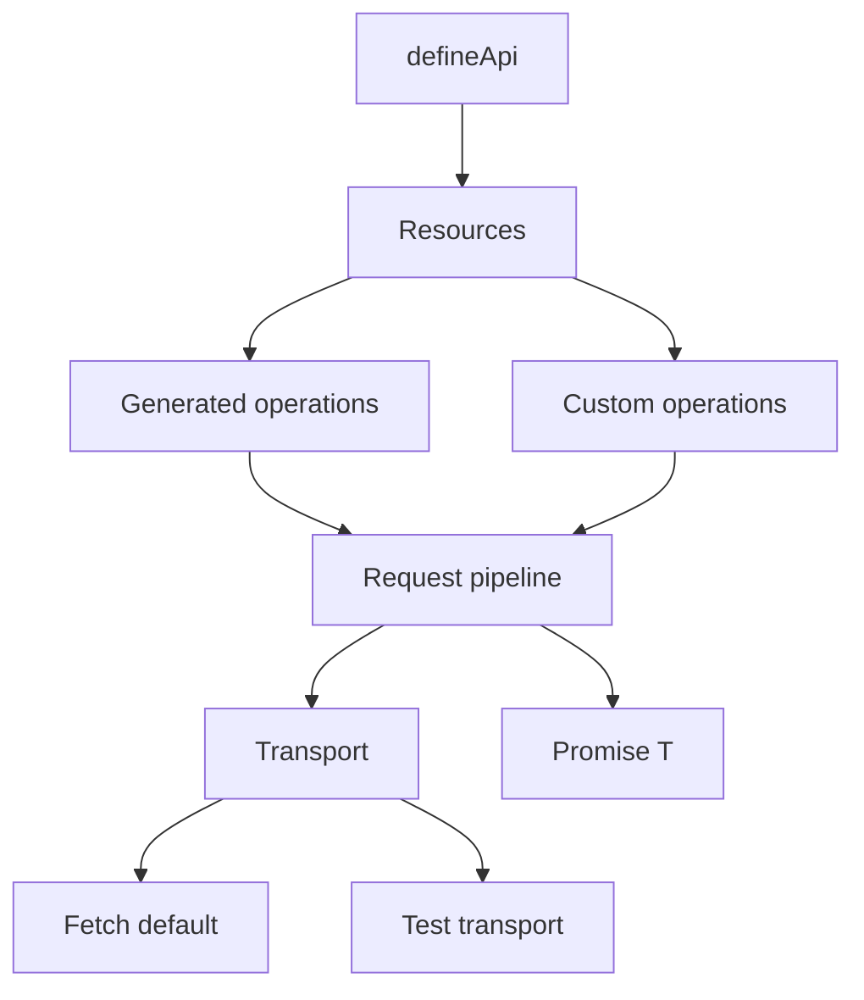

# Architecture

This document describes the architecture Apixa is building toward, and how the current codebase maps to it.

Apixa Core owns definitions, validation, and one execution lifecycle that ends in either HTTP or
the in-memory mock engine (see [ADR 003](./decisions/003-client-scoped-mocking-in-core.md)).
`@apixa/mocking` ships the dataset records, which load lazily and one dataset at a time through
`@apixa/mocking/datasets`, plus the standalone `defineMockApi()`, a thin adapter over Core's
`MockStore`. Other optional packages (client, server, TanStack Query, OpenAPI) remain planned
boundaries.

## High-level shape

```text
defineApi({ baseURL, headers, resources: { … } })   defineApis({ a: {…}, b: {…} })
        │
        ▼
   typed API client
        │
        ├── resource (users, posts, …)
        │       ├── generated operations (getAll, getById, create, …)
        │       └── custom operations (explicit endpoints)
        │
        ▼
   request pipeline
        │
        ├── URL / path / query construction
        ├── headers + body serialization
        ├── Transport.request(...)
        └── parse / errors → Promise<T>
```



## Design rules

1. **Single source of truth** — resources and operations are defined once.
2. **Type inference first** — argument, body, and response types come from definitions.
3. **Runtime config is authoritative** — resources live under `resources`; generic metadata supplies types only and never creates a resource or operation. Built-in CRUD exists for a resource with `path`; optional `operations` merges overrides; custom/explicit settings win.
4. **Native promises** — no custom Promise wrappers in Core.
5. **Framework-agnostic** — Core must not depend on React, Next.js, or TanStack Query.
6. **Transport-backed** — HTTP runs through a `Transport` interface; Fetch is the default implementation and stays **inside Core** until a package split is justified.
7. **Operations are add / remove / override, by name** — all 16 builtins are enabled by default. `defaultOperations`, read/write flags, groups, and individual entries resolve once at client construction. Each builtin has its own resolved request definition; custom functions use the shared `ctx.request()` pipeline. Runtime config controls the client shape and paths, while generic metadata controls payload types (see [conventions.md](./conventions.md#operation-customization)).

See also:

- [001-framework-agnostic-core.md](./decisions/001-framework-agnostic-core.md)
- [002-transport-abstraction.md](./decisions/002-transport-abstraction.md)
- [003-client-scoped-mocking-in-core.md](./decisions/003-client-scoped-mocking-in-core.md)

## Request flow

`defineApi()` and `defineApis()` share one engine (`api/client.ts`). Construction validates
everything, resolves each operation once (selection, defaults, layers, transforms, retry
policy) and returns a frozen client. It makes no network calls and loads no datasets.

Every call then runs through `request/pipeline.ts`:

1. Use the effective config pre-resolved on the operation. Precedence is root < resource <
   operation < request.
2. Resolve dynamic headers. Static, sync, and async providers run once per logical call and
   merge case-insensitively.
3. Run request middleware (root → resource → operation; `middleware.onRequest` before
   `requestMiddleware[]`).
4. Apply request key transforms. Query keys convert when the URL is built; body keys convert
   at serialization.
5. For HTTP only, check the final URL against the API origin after middleware. Any other
   origin is a `SecurityError`, and nothing is sent.
6. Execute. For HTTP, transport attempts run with retry, exponential backoff with jitter, and
   `Retry-After`. Middleware does not re-run on retries. For a mocked resource, the resolved
   builtin runs against its `MockStore`, or `ctx.request()` is routed by method and relative
   path. No transport is involved.
7. Apply response key transforms and operation shaping (`exists`, `getMany`, `findFirst`,
   `slice`).
8. Run response middleware.
9. Return the data, or the `ApiResponse` envelope when `{ full: true }` is passed.

One controller per call combines the overall timeout and the caller's signal. A timeout covers
retries and backoff, and is reported as `TimeoutError`, never as `AbortError`. On failure, error
middleware runs (root → resource → operation). A handler that throws replaces the error; one
that returns a value other than `undefined` recovers the call.

## Source map (`packages/core`)

| Responsibility       | Home         | Notes                                                                  |
| -------------------- | ------------ | ---------------------------------------------------------------------- |
| Client construction  | `api/`       | `defineApi`, `defineApis`, `resetMock`, validation, resource builder   |
| Operation selection  | `operation/` | Builtin conventions, precedence (`expand.ts`), argument parsing        |
| Execution lifecycle  | `request/`   | `pipeline.ts` (single lifecycle), `retry.ts`                           |
| Mock engine          | `mock/`      | `MockStore`, data sources, builtin/route executors, dataset metadata   |
| Key transforms       | `transform/` | Runtime converters (types in `types/transform.ts`)                     |
| URL / headers / body | `http/`      | Base URL parsing, origin checks, header providers, query, body         |
| Fetch transport      | `transport/` | Default transport                                                      |
| Errors               | `errors/`    | `ApiError` + HTTP/Network/Timeout/Abort/Config/Security/Transform/Mock |
| Types                | `types/`     | Definition, inference (runtime-authoritative), transforms, datasets    |

## Workspace today vs planned

**Today:**

```text
packages/core/
packages/mocking/          # dataset records (lazy), defineMockApi adapter, Node loaders
packages/tanstack-query/   # optional; unified useResourceQuery (v0.8.0)
datasets/                  # version-controlled JSON fixtures
examples/next/             # primary playground (uses mocking + tanstack-query)
tests/                     # vitest — Core + mocking + tanstack-query
```

**Planned later (do not create yet):**

```text
packages/transport-fetch/
packages/client/
packages/server/
packages/openapi/
```

A future **online dataset catalog** may reuse the local `meta.json` shape; hosting is not implemented.

Integrations always depend on Core. Core never depends on integrations.

## Related docs

- Living context: [context.md](./context.md)
- Roadmap: [roadmap.md](./roadmap.md)
- Latest coding contract: [../versions/v0.8.0/](../versions/v0.8.0/) (shipped; see [versions/README.md](../versions/README.md))
