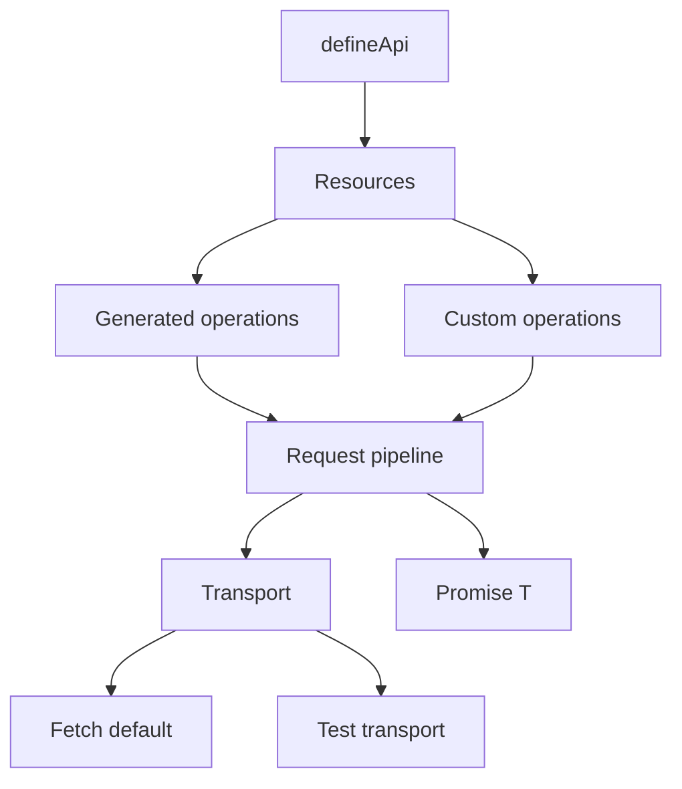

# Architecture

This document describes the architecture Apixa is building toward, and how the current codebase maps to it.

Apixa Core owns definitions, validation, and one execution lifecycle that ends in either HTTP or
the in-memory mock engine (see [ADR 003](./decisions/003-client-scoped-mocking-in-core.md)).
Mocking owns lazy dataset records and `defineMockApi()`, a thin adapter over Core's `MockStore`.
React owns the optional React integration with TanStack Query as its engine. The only npm package
is `apixa`; `src/` contains re-export entry points. Core, Mocking, React and shared helpers are
private workspace modules whose canonical source is compiled into this single distribution.
React and TanStack remain optional external peers. Core imports neither.

## High-level shape

```text
defineApi({ baseURL, headers, resources: { … } })   defineApis({ a: {…}, b: {…} })
        │
        ▼
   typed API client
        │
        ├── resource (users, posts, …)
        │       ├── generated operations (getAll, getById, create, …)
        │       └── custom operations (explicit endpoints)
        │
        ▼
   request pipeline
        │
        ├── URL / path / query construction
        ├── headers + body serialization
        ├── Transport.request(...)
        └── parse / errors → Promise<T>
```



## Design rules

1. **Single source of truth** — resources and operations are defined once.
2. **Type inference first** — argument, body, and response types come from definitions.
3. **Runtime config is authoritative** — resources live under `resources`; generic metadata supplies types only and never creates a resource or operation. Built-in CRUD exists for a resource with `path`; optional `operations` merges overrides; custom/explicit settings win.
4. **Native promises** — no custom Promise wrappers in Core.
5. **Framework-agnostic** — Core must not depend on React, Next.js, or TanStack Query.
6. **Transport-backed** — HTTP runs through a `Transport` interface; Fetch is the default implementation and stays **inside Core** until a package split is justified.
7. **Operations are selected and overridden by name** — the `operations` preset, list and named overrides resolve once at client construction. Each builtin has its own resolved request definition; custom functions use the shared `ctx.request()` pipeline. Runtime config controls the client shape and paths, while generic metadata controls payload types (see [conventions.md](./conventions.md#operation-customization)).

See also:

- [001-framework-agnostic-core.md](./decisions/001-framework-agnostic-core.md)
- [002-transport-abstraction.md](./decisions/002-transport-abstraction.md)
- [003-client-scoped-mocking-in-core.md](./decisions/003-client-scoped-mocking-in-core.md)

## Request flow

`defineApi()` and `defineApis()` share one engine (`api/client.ts`). Construction validates
everything, resolves each operation once (selection, defaults, layers, transforms, retry
policy) and returns a frozen client. It makes no network calls and loads no datasets.

Every call then runs through `request/pipeline.ts`:

1. Use the effective config pre-resolved on the operation. Precedence is root < resource <
   operation < request.
2. Resolve dynamic headers. Static, sync, and async providers run once per logical call and
   merge case-insensitively.
3. Apply request key transforms (with optional `exclude` / `preserve` / `maxDepth`) to query and
   body payloads before middleware runs, leaving `File` / `Blob` values untouched.
4. Run unified `middleware` `onRequest` hooks (root → resource → operation, in array order). Request
   middleware sees `request.query` and `request.body`; mutations to `request.query` or `request.url`
   stay synchronized across live transport, mocks, URL serialization, and metadata.
5. For HTTP only, check the final URL against the API origin after middleware. Any other
   origin is a `SecurityError`, and nothing is sent.
6. Execute. For HTTP, transport attempts run with retry, exponential backoff with jitter, and
   `Retry-After`. Middleware does not re-run on retries. For a mocked resource, the resolved
   builtin runs against its `MockStore`, custom declarative operations run their `mock` handler, or
   `ctx.request()` is routed by method and relative path. No transport is involved. Writes carrying
   `File` / `Blob` values first move them into the client's virtual file store (see "File handling");
   records keep string references.
7. Run response processing in order (skipped for non-JSON `responseType`): preserve raw parsed
   payload as `source`, run `response.unwrap`, apply response key transforms (`TransformError` on
   cycles/depth/collisions), resolve per-operation or resource `pagination`, run `response.parse` and
   `response.validate` (`ValidationError` on non-`ApiError` throws), and apply builtin shaping
   (`exists`, `getMany`, `findFirst`, `slice`, `ResponseShapeError` on invalid shapes).
8. Run unified `middleware` `onResponse` hooks.
9. Return the data, or the `ApiResponse` envelope (including `source`) when `{ full: true }` is passed.

One controller per call combines the overall timeout and the caller's signal. A timeout covers
retries and backoff, and is reported as `TimeoutError`, never as `AbortError`. On failure, error
middleware runs (root → resource → operation). A handler that throws replaces the error; one
that returns a value other than `undefined` recovers the call.

## React peer guard (v1.1.0, implemented)

`@tanstack/react-query` is an optional peer of the single package. An unresolved import is an
error type that behaves as `any`, and `any & X` is `any`, so hook results built on TanStack's
`UseQueryResult` would silently lose every type. `packages/react/src/peer.ts` probes
`unknown extends QueryClient` and every hook overload returns `RequireTanStackQuery<Result>`:
the real result when TanStack resolves, otherwise a named error interface. Verified by
`scripts/verify-type-consumers.mjs` (npm, packed tarball, outside the workspace). Limit: under
`skipLibCheck: true` TypeScript cannot report the unresolved module itself; the guard type is the
detectable failure. `ApixaProvider`, `QueryClient` and the hydration components extend/take
TanStack types and are not guarded (they need the package at runtime anyway).

## Downloads and binary responses (v1.2.0, implemented)

`responseType` already reached the Fetch transport per call; v1.2.0 completes it inside the same
operation system. A declarative operation can declare `responseType` (precedence: call option >
operation > JSON); `pipeline.ts` validates it, passes it to the transport and, for non-JSON types,
skips key transforms and JSON shaping (`fromHttp`, `slice`). `transport/read-body.ts` reads a
successful body as requested but always reads an error body by content type, and returns typed
empty values for 204/205. Types: `ResponseTypeData` plus `ApplyResponseType` (runtime literal,
beneath `defineApi<T>()` metadata) and `CallData` (per call, `ctx.request` overloads).
Metadata is the existing `ApiResponse`; `http/content-disposition.ts` is a pure parser. Mock
operations read the v1.1.0 `MockFileStorage` through a read-only `files` handle, and
`finalizeMockResponse` (`mock/files.ts`) coerces results to `responseType` and synthesizes the
content headers. No new package, transport interface or download client.

## Transfer progress, streaming and reliability (v1.3.0, implemented)

One opt-in `onTransfer` observer (call option, or an operation default; the call wins) rides the
existing pipeline; nothing is wrapped without it. `request/pipeline.ts` creates one `TransferChannel`
(`transfer/channel.ts`) per attempt and hands its `sink` to the transport as the optional
`TransportRequest.onTransfer`. The fetch transport reports bytes it actually moves: request bodies
are counted by a pull-based `countedStream` (`transfer/counting.ts`, `highWaterMark: 0`, so
backpressure and cancellation reach the source) and response bodies are counted before the existing
`readBody` decodes them, so observed and unobserved results are byte-equal. The channel enforces the
contract: per direction `start`, `progress`\*, then exactly one of `complete` / `error` / `abort`,
or a single `unsupported`. A custom transport that ignores `onTransfer` still works and is
reported `unsupported`; mocks report real sizes only (binary/text) and never invent bytes.

Honesty rules. Upload `loaded` counts bytes pulled from the request body for the network stack,
never server acknowledgment. A sized body (`Blob`, `File`, buffers, strings, `FormData`) is observed
only when the runtime lets Apixa keep the original `Content-Length` and `Content-Type`
(`detectTransferSupport().uploadProgress`, from feature probes); browsers forbid setting
`Content-Length`, so there those uploads are sent untouched and reported `unsupported`. A caller
`ReadableStream` is counted wherever streaming bodies exist (`duplex: "half"` is now always set);
browsers need HTTP/2 or newer for it and refuse otherwise (an `error`, never a fake completion).
Download `total` is a finite `Content-Length` on an uncompressed, non-empty response; otherwise
absent, and dropped if the body outgrows it. No `XMLHttpRequest` fallback (a second execution path,
absent in Node and Edge).

Stream ownership. A `responseType: "stream"` result is bound to its call (`transfer/stream.ts`):
the caller signal and overall timeout stay in force until the stream ends, fails or is cancelled,
and cleanup happens then, not when the operation Promise resolves. Abort errors the stream with
`AbortError`, a timeout with `TimeoutError`. Retries are unchanged (a request stream is never
replayed); each attempt starts a new event sequence at `loaded: 0`, and an `error` event says
whether a retry follows (`willRetry`). `ApiError.transfer` carries direction and bytes for a failure
during an observed transfer.

## File lifecycle and hardening (v1.8.0, implemented)

Guarantees are stated per owner (`docs/guides/humans/production-file-handling.md`): Apixa owns client-side mock storage
(atomic managed commits per client; low-level `delete`/`clear` stay deliberate and may leave stale refs) and its own
transfer sessions (part delivery at least once, completion exactly once by authoritative reconciliation, abort ordered
against completion); a backend owns remote files, sessions and their expiry; the author owns replacement and deletion
policy. Apixa never deletes a remote file because a frontend record changed and makes no cross-system atomicity claim.
Resource bounds: advanced upload memory is `concurrency x chunkSize` plus one hash chunk; checkpoint bookkeeping is O(1)
per acknowledgment (sorted ledger, running size total, frozen shared manifest); a raw `Blob` with `onTransfer` streams.
Redirects of ordinary requests are inspected hop by hop in `transport/redirects.ts` (`fetchSafely`): same-origin followed,
cross-origin refused before it is contacted, `redirectOrigins` followed bare (GET/HEAD), browsers (opaque redirects) fail
closed; presigned steps keep `redirect: "error"`. Known limits kept visible: a cached stream is consumer-owned (cancelling an unlocked replaced stream would read as an
empty success), custom transports must bound their own reads, custom headers follow cross-origin redirects, `session.id`
is opaque input. Evidence: `tests/core/advanced-transfer-{races,faults}`, `file-{security-boundaries,memory-bounds,
error-matrix}`, `mock-file-lifecycle`, `tests/react/file-{stream-lifecycle,error-propagation}` and
`scripts/measure-file-memory.mjs`.

## Files through the framework integration (v1.6.0, implemented)

No new hook or store: files ride the existing hooks and Core operations. Audit findings (see
`versions/v1.6.0/implementation-plan.md`): a binary value in a **generated query identity** now throws
(`assertNoBinaryIdentity` in `query-options.ts`) because TanStack hashes `File`/`Blob`/`ArrayBuffer`/`FormData`/stream
as `{}` (silent cache collision); `bindSignal` combines a caller's `signal` with TanStack's query signal (a read's
caller signal used to be overwritten); `dehydrate` (`hydration.ts`) leaves binary and stream query data out of the
Server -> Client payload. Unchanged by design: resource-wide mutation invalidation (scoped via the existing
`invalidate` option), a stream held in the query cache is the app's to consume (Core's `timeout` bounds it), and flat
reads through a hook are cached queries. Evidence: `tests/react/framework-files-*.test.tsx`, `query-identity-binary`,
`ssr-binary-dehydrate`, the packed React 18/19 runtime (`scripts/file-consumer-runtime.mjs`) and the Chromium-driven
`examples/frontends/query-ssr-next` `/files` scenario.

## File validation and safety (v1.4.0, implemented)

Opt-in rules live where files are already declared: `FileFieldOptions` (`minSize`, `maxSize`, `min`,
`max`, `accept`, `reject`, `unknownType`, `noExtension`, `filename`) and `fileLimits`
(`maxTotalSize`, `maxFiles`, `maxBodySize`) on the resource, overridable key-wise per operation
(`fileFields` for declared fields, `fileLimits`); `maxResponseSize` / `responseAccept` belong to
operations (a per-call `maxResponseSize` wins). `prepareFiles` resolves them once into
`PreparedOperation.fileRules`, which is `undefined` unless something is configured, so unconfigured
calls do no work. There is no per-call opt-out.

One checkpoint in `runOperation` (`validation/`), after request middleware and key transforms and
before serialization, the transport and mock execution, runs `validateRequestFiles` over the wire
body: a bounded, cycle-safe walk reading metadata only (`size`, `type`, `name`, never bytes). The
mock branch passes through the same step, so a rejected request makes no transport call, no mock
write and no transfer event, and is thrown as the existing `ValidationError` with typed
`violations` (`code`, `path`, `limit`, `actual`, `rule`; no file names or contents). Field rules
apply to files in declared fields (and caller `FormData` parts, by alias); raw `Blob` / buffer /
string / stream bodies are governed by `maxBodySize` / `maxTotalSize` only.

Streams and responses are bounded by the v1.3.0 counting stream, which gained a byte `limit`
(pull-based, no buffering): a request stream is wrapped by the pipeline (the original error is kept
and surfaced instead of fetch's generic failure), buffered response types are counted in the fetch
transport (`TransportRequest.limits`) after an early reject from a trustworthy `Content-Length` or
declared `Content-Type`, and a `stream` result is counted in the pipeline before stream-lifetime
binding. The pipeline re-checks heads and fully read bodies for custom transports. A failed (non-2xx) response
keeps its status and `HttpError`, but its body is bounded by the same limit (the fetch transport drops an
oversized error body, `data` is `null`, instead of buffering it; custom transports are not bounded). A `ValidationError` is never retried.

Trust boundary. These checks are developer experience, not security. `File.type` and `File.name`
are chosen by whoever built the `File`, an extension does not prove content, and no content sniffing
happens. The backend must validate again. A limit hit mid-stream is best effort: bytes up to the
limit may already have been sent or received.

## File handling (v1.1.0, implemented)

Files travel inside the existing operations; there is no separate upload client.

**Declaring file fields.** `fileFields: ["avatar", "documents"]` or
`fileFields: { avatar: { name: "profile_image" } }` on a resource. Names are checked against the
entity (compile time) and must be `string` / `string[]` fields (nullable allowed). Reads keep
those types. Eligible writes (`create`, `update`, `patch`, `createMany`) accept
`File | Blob` and `readonly (File | Blob)[]` for them, preserving optionality and `null`. Explicit
body types and `dataFormat: "json"` keep the entity types; custom operations are not rewritten.
A stored `string` is not accepted as a file input — omit the key to keep the file.

**Choosing the format** (at serialization, after middleware and key transforms):

1. Caller-built `FormData` / `Blob` / string / buffers / streams are sent as is; for `FormData`
   Core removes `Content-Type` so the transport generates the boundary.
2. Plain objects and arrays: JSON by default; multipart automatically when the body contains a
   `File` / `Blob` anywhere; `dataFormat: "multipart"` always encodes.
3. `dataFormat: "json"` with binary values throws `SerializationError`. Binary values are never
   JSON-stringified. `dataFormat` exists on write operations only; `ctx.request({ dataFormat })`
   offers the same override to function operations.

**Multipart encoding** (`http/multipart.ts`):

| Value                                                           | Wire                                                              |
| --------------------------------------------------------------- | ----------------------------------------------------------------- |
| string, number, boolean, bigint                                 | text part (`String(value)`)                                       |
| `Date`                                                          | ISO-8601 text                                                     |
| `File` / `Blob`                                                 | file part; name, type, bytes kept (a bare `Blob` is `blob`)       |
| `undefined`                                                     | omitted                                                           |
| `null`                                                          | empty text part; `multipart.nulls: "omit"` drops it               |
| nested object                                                   | `parent[child]`, recursively                                      |
| array of scalars                                                | `key[]`; `multipart.arrays` → `"indices"` (`key[0]`) / `"repeat"` |
| array of objects                                                | `key[0][field]`                                                   |
| array of files                                                  | repeated `key` (or alias)                                         |
| top-level array body (`createMany`)                             | `items[0][field]`                                                 |
| `multipart.jsonFields` entry                                    | one part with `JSON.stringify(value)`                             |
| function, symbol, class instance, `FileList`, cycle, depth > 32 | `SerializationError` with the path only                           |

`fileFields[name].name` aliases a top-level part name verbatim; `multipart` (resource, overridable
per operation) holds `jsonFields`, `nulls` and `arrays`. Aliases and `jsonFields` use public field
names and follow the request key transform. Serialization runs once per logical call: the built
`FormData` is reused by every retry attempt, `ReadableStream` bodies are never retried, and the
caller's object is never mutated. Convert a `FileList` explicitly (`Array.from(input.files)`) before
passing it; Core takes native `File` values only, so form libraries such as React Hook Form work
without an adapter.

**Mock file storage** (`mock/files.ts`, `mock/files-exec.ts`, `mock/transaction.ts`). Each client
has one in-memory `MockFileStorage`. UUID refs remain `mock-file://<id>/<encoded-name>`; IDs, not
paths or suffixes, resolve bytes. Defaults preserve original filenames and use an ID directory in
metadata to avoid path collisions. Optional `mock.storage` resource defaults (`disk`, `directory`,
`naming`, `generateId`) organize the same store. Paths use `/`, preserve case/Unicode and reject
absolute paths, traversal, encoded traversal/separators, schemes and controls. A logical disk is
organization, not an access-control boundary. Metadata adds optional `disk`, `path`, `originalName`
for structural compatibility; normalized entries always include disk/path. Listing is a linear,
metadata-only filter by resource, field, disk and segment-aware path prefix.

`mockFileFixture` creates a runtime-neutral descriptor; `mockFixtureRef(key)` is an explicit
`{ $apixaFixture: key }` seed marker, never an ordinary string. The resource's optional `mock.fixtures`
registry resolves only selected seed records' declared file fields, sequentially and single-flight.
Exposed records contain ordinary refs. Unknown markers/keys fail initialization; a configured
registry also rejects missing local UUID refs. Legacy sources without a registry keep arbitrary
reference strings. Fixture rules reuse the existing validator with stored metadata (no byte copies
for validation, including without a File constructor). Cached catalog records are never mutated.

Managed writes serialize per resource and use copy-on-write record drafts plus private file staging.
Commit publishes bytes, records and ownership together after mock result preparation/response-limit
checks. Failed bulk writes, byte reads, naming, validation, abort, timeout or reset before commit
publish nothing. Handlers keep raw bodies and read their own draft writes; successful handler file
values become refs. A handler throw discards its writes and a completed/aborted handle rejects late
writes. This strengthens the earlier immediate-write/no-rollback handler semantics. User-defined
external effects and response middleware **after commit** are outside rollback. Ordinary builtin
reads use the existing record indexes without copying transaction indexes or scanning every row.

Automatic cleanup tracks each resource's committed refs and fixture baseline pins. Removing one
record/reference preserves bytes still owned by another record/resource; last-owner removal releases
managed files. Public `put` entries remain manually owned until explicit deletion/clear/reset.
`resetMock` synchronously invalidates pending generations, releases transient ownership and preserves
another resource's active refs; seed files rehydrate lazily on the next awaited operation. A reset
may generate new UUID refs; injected generator state is caller-owned and is not rewound. Direct
`mockFiles` reads remain synchronous, so files can be absent between reset and rehydration. Explicit
`delete`/`clear` remain destructive tools and can leave stale record refs; they never rewrite records.
Low-level missing reads return undefined/false; handler get/meta throws `MOCK_NOT_FOUND`.

`defineMockApi` adapts its established calling conventions to the existing Core mocked-client
pipeline and `MockApiError` mapping. Its mutable `rows()` callbacks now operate on private copies
reconciled on successful completion, with no rollback claim for external effects. A non-enumerable
internal target link lets `mockFiles`/`resetMock` resolve adapter wrappers without a public registry
or new transaction API. Core has no dependency on Mocking. All bytes stay client-owned: staging
shares immutable committed byte buffers and releases its snapshots/reservations at settlement.
`get().bytes()/blob()` still return defensive copies; record reads/listing never copy stored bytes.
No object URLs, storage drivers, Node filesystem requirements or provider dependencies are added.
Fixtures emit no transfer events during setup; operation events and validation retain v1.3.0/v1.4.0
semantics, including unsupported mock uploads and stream responses.

## Source map (`packages/core`)

| Responsibility       | Home         | Notes                                                                                |
| -------------------- | ------------ | ------------------------------------------------------------------------------------ |
| Client construction  | `api/`       | `defineApi`, `defineApis`, `resetMock`, validation, resource builder                 |
| Operation selection  | `operation/` | Builtin conventions, precedence (`expand.ts`), argument parsing                      |
| Execution lifecycle  | `request/`   | `pipeline.ts` (single lifecycle), `retry.ts`                                         |
| Mock engine          | `mock/`      | `MockStore`, data sources, executors, dataset metadata, file store                   |
| Key transforms       | `transform/` | Runtime converters (types in `types/transform.ts`)                                   |
| URL / headers / body | `http/`      | Base URL parsing, origin checks, header providers, query, JSON/multipart body        |
| Fetch transport      | `transport/` | Default transport                                                                    |
| Transfer events      | `transfer/`  | Capability probe, counting streams, per-attempt event channel, stream ownership      |
| Errors               | `errors/`    | `ApiError` + HTTP/Network/Timeout/Abort/Config/Security/Transform/Serialization/Mock |
| Types                | `types/`     | Definition, inference (runtime-authoritative), transforms, datasets                  |

## Architecture contract (v1.0.0)

Enforced by `pnpm check:architecture` (`scripts/check-architecture.mjs`, TypeScript module
resolution over every package's real import graph, plus the built output). Marked **implemented**
or **planned**. Rationale: [ADR 005](./decisions/005-single-package-distribution.md).
Export contracts: [public-api.md](./public-api.md).

| Package                  | Owns                                                                                                                                                      | May import                                                       | Status               |
| ------------------------ | --------------------------------------------------------------------------------------------------------------------------------------------------------- | ---------------------------------------------------------------- | -------------------- |
| `@apixa/core`            | Definitions, operations, request lifecycle, middleware, transforms, retry, errors, types, metadata, the `MockStore` bridge                                | nothing (no framework, no Node)                                  | implemented, private |
| `@apixa/mocking`         | `defineMockApi`, dataset catalog/loaders/modules, mock errors, `register`, Node utilities                                                                 | Core; `node:*` only from `node.ts`                               | implemented, private |
| `@apixa/internal-shared` | Framework-neutral integration algorithms (resource keys, operation classification)                                                                        | Core only                                                        | implemented, private |
| `@apixa/react`           | `useResource*` hooks, `ApixaProvider`, `QueryClient`, `ApixaHydrationBoundary`, controllers, query options, cache sync, optimistic layers, mutation store | Core, shared, `react`, `@tanstack/react-query`                   | implemented, private |
| `apixa`                  | Entry points and curated re-exports only (the repository root package)                                                                                    | `@apixa/core`, `@apixa/mocking`, `@apixa/react` (private source) | implemented, public  |

```text
@apixa/core  ◀── @apixa/mocking
     ▲
     └────────── @apixa/internal-shared ◀── @apixa/react
                                                   └── @tanstack/react-query, react (peers)
apixa public entries ──▶ compile private Core, Mocking, React and shared source into dist
```

Rules (each is checked, except where noted):

1. Core never imports an integration, a framework, a built-in Node module, or another workspace package.
2. The shared layer imports only Core and no framework. It is private: a `devDependency` of its
   consumers, bundled into their output, never a runtime or peer dependency, never named in
   published JavaScript or declarations.
3. Mocking depends on Core, never the reverse. Named datasets load lazily; only `datasets.ts` and
   `dataset-modules/*` import dataset JSON statically. `node:*` is confined to the closure of `node.ts`.
4. Framework integrations never import each other and never import Mocking.
5. Relative imports stay inside the package's `src` (Mocking may reach the repo-root `datasets/` JSON).
   Cross-package imports use the package name and a subpath in its `exports` map, never `src/`.
6. No cycles, at package or module level (type-only and dynamic imports excluded).
7. Public entries re-export; they never `export *` from the private shared layer. Facade files
   contain only re-exports, and `apixa/react` lists exactly the names `@apixa/react` exports
   (a client boundary may not use `export *`). (checked)
8. Root/Core/Mocking runtime and declaration closures stay framework-free. Node imports stay
   confined to `apixa/mocking/node`. Missing relative emitted modules and private bare imports fail checks.
9. Runtime: one multi-entry code-split build resolves private workspace names to canonical source
   via `tsconfig.publish.json`. React and TanStack remain external. Each Core class, MockStore,
   QueryClient, provider, mutation store and optimistic layer has one definition in `dist`.
   Packed consumers prove cross-subpath identity, dataset array identity and registration.
10. Declarations: a separate TypeScript emit preserves one declaration per source module under
    `dist/types`, rewriting private imports to relative paths. Facade declaration entries re-export
    those canonical modules. This preserves unique symbols, generic inference and type identity,
    without the cross-entry React imports introduced by declaration bundling. The entire emitted
    declaration closure is typechecked, including TypeScript 5.5.4 in clean external consumers.
11. Only `apixa/react` is a client boundary. `apixa/react/advanced` must not reach a client chunk
    or React runtime import. Real Next Server Components construct a request-scoped QueryClient,
    prefetch, and pass state to the hydration boundary. Native TanStack providers remain compatible.
12. Only root `apixa` is publishable; all implementation manifests have `private: true`. Root has
    no workspace dependencies, runtime dependencies or mandatory framework peers. Build aliases
    replace installed private dependencies. RC publication targets root only, ESM, Node >=22, tag `next`.
13. `pnpm verify:consumers`, `verify:browser` and `verify:edge` install one root tarball. Private
    module builds remain available for independent development and source tests, but are never packed
    for consumer verification or release. `pnpm verify:publish` only reads npm state and dry-runs one tarball.

### Where does new code go?

| If it…                                                                                    | It belongs in                                                                                 |
| ----------------------------------------------------------------------------------------- | --------------------------------------------------------------------------------------------- |
| defines, resolves, executes or types an API operation                                     | `@apixa/core`                                                                                 |
| supplies datasets, mock adapters, or dataset loading                                      | `@apixa/mocking`                                                                              |
| is a pure algorithm two framework integrations would both need, and uses nothing but Core | `packages/internal/shared` — only once a real second consumer or an existing duplicate exists |
| touches `QueryClient`, observers, hooks, React context, hydration                         | the React package                                                                             |
| only re-exports                                                                           | the `apixa` facade                                                                            |

### Shared integration layer today

Extracted (pure, tested in `tests/internal-shared/`): `createResourceKeys` (key hierarchy) and
`describeOperations` / `assertNoFullResponse` (Core-metadata-based operation classification). Kept
React/TanStack-specific on purpose: `query-options` (TanStack `queryOptions`), `cache` and
`optimistic` (mutate a `QueryClient`), `mutation-store` / `mutation-controller` (TanStack mutation
semantics), `compose` (TanStack's tracking proxy), and all hooks. Invalidation policy and optimistic
algorithms may move once a second integration needs them; moving them earlier would be speculative.

### Extending to another framework (future, not started)

A future integration is a private workspace module that imports Core and `@apixa/internal-shared`, adds its own
adapter for its framework's cache, and is added to the package table in the check script and to
`public-api.md` with its `apixa/<framework>` subpath. Vue and Angular packages do not exist and must not be created ahead of that work.

### Stability

Public symbols listed in `public-api.md` keep their signatures. Moving code between internal
modules must not change emitted behavior, error text, or declaration shapes of public symbols.

## Workspace today vs planned

**Today:**

```text
packages/core/
packages/mocking/          # datasets entry (lazy loadDataset + eager records), defineMockApi adapter, Node loaders
packages/react/            # @apixa/react: native Query reads + separate Mutation writes, provider, QueryClient
packages/internal/shared/  # private, never published: framework-neutral keys + operation classification
datasets/                  # version-controlled JSON fixtures
examples/
  backends/laravel-backend/           # independent Laravel/PostgreSQL/MongoDB playground (no app endpoints)
  frontends/query-ssr-next/           # maintained Next.js App Router example (prefetch, hydration, files)
  frontends/next/                     # local, untracked Next.js playground
  templates/{laravel,next,react}/     # empty starter placeholders
src/                       # the `apixa` facade: re-export entries only
tests/                     # vitest — Core + mocking + react + facade + shared
```

**Planned later (do not create yet):**

```text
packages/transport-fetch/
packages/client/
packages/server/
packages/openapi/
```

A future **online dataset catalog** may reuse the local `meta.json` shape; hosting is not implemented.

Integrations always depend on Core. Core never depends on integrations. Machine-checked: see the
architecture contract above.

## Related docs

- Living context: [context.md](./context.md)
- Public API contract and migration map: [public-api.md](./public-api.md)
- Roadmap: [roadmap.md](./roadmap.md)
- Latest coding contract: [../versions/v3.0.0/](../versions/v3.0.0/) (active; see [versions/README.md](../versions/README.md))

## Advanced transfers (v1.7.0; implemented, not npm-published)

Advanced uploads are optional operation strategies inside Core's existing `transfer/` area.
`runOperation` builds the logical request, runs its request middleware and whole-source validation,
then invokes the private session orchestrator instead of sending the outer body once. Protocol
steps recursively use `runOperation` with strategy selection disabled; `sendWithRetry` remains the
only transport attempt/retry loop. Root/resource middleware applies to step requests, while the
outer operation's middleware runs on the logical call and final result. Protocol requests have
explicit validated method kinds; ordinary function request classification is unchanged.

One overall deadline/signal covers the session, child calls, backoff, hashing, pause and persistence.
A finite worker set slices parts lazily; one sequential digest pass creates a capped chunk-manifest
identity where resume requires it. Checkpoints hold metadata, not binary source or delegated URLs;
reconciliation uses authoritative backend parts, never local flags alone. Successful logical
completion requires decoded backend confirmation. The final real response supplies full metadata.
Session observation and controls are optional inputs; operations remain native promises and hooks
remain consumers of Core. No global scheduler, cache or separate transfer client is introduced.

Presigned requests require an explicit exact-origin policy and a transport capable of enforcing
credential omission/redirect rejection. They bypass inherited auth providers and ordinary request
middleware, use a separate explicit trusted request-middleware list, and are revalidated before
transport. Ordinary calls retain their existing same-origin guard. Signed URL/credential metadata
is sanitized before response/error middleware and error observation; request replay is disabled for
signed failures. Custom transports opt in explicitly. Backend protocol decoders and trusted
middleware remain application code and must not expose secrets or fabricate acknowledgments.

S3 integration is a tested backend-mediated recipe in the maintained Next example, not a public
provider abstraction. Existing mock storage remains a client-scoped record/file engine and does not
become a multipart session server. Ranged downloads, mandatory whole-file hashing dependencies and
background persistence remain outside this milestone. See the [Core recipes](../packages/core/README.md#advanced-transfers-v170)
and [version decisions](../versions/v1.7.0/implementation-plan.md).
