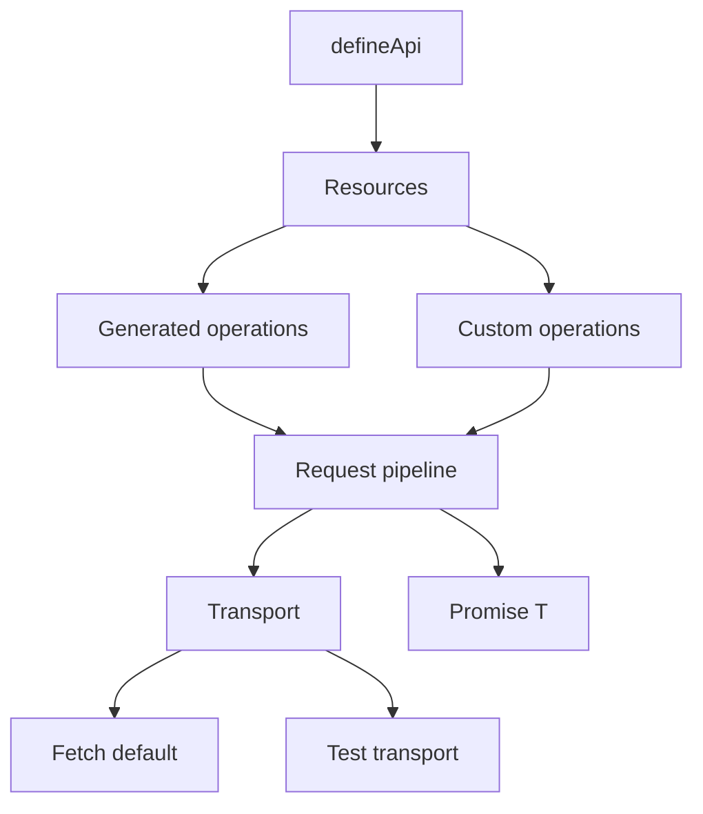

# Architecture

This document describes the architecture Apixa is building toward, and how the current codebase maps to it.

Apixa Core owns definitions and live HTTP execution. `@apixa/mocking` is a separate package: a standalone in-memory mock API (`defineMockApi()`) plus resource `mock` / `mockConfig` support. Core lists mocking as an **optional peer** and lazy-loads `@apixa/mocking/register` when those keys are present — it does not embed a mock engine. Other optional packages (client, server, TanStack Query, OpenAPI) remain planned boundaries.

## High-level shape

```text
defineApi({ baseURL, headers, resources })
        │
        ▼
   typed API client
        │
        ├── resource (users, posts, …)
        │       ├── generated operations (getAll, getById, create, …)
        │       └── custom operations (explicit endpoints)
        │
        ▼
   request pipeline
        │
        ├── URL / path / query construction
        ├── headers + body serialization
        ├── Transport.request(...)
        └── parse / errors → Promise<T>
```



## Design rules

1. **Single source of truth** — resources and operations are defined once.
2. **Type inference first** — argument, body, and response types come from definitions.
3. **Default-first conventions** — built-in CRUD exists for a resource with `path`; optional `operations` merges overrides; custom/explicit settings win.
4. **Native promises** — no custom Promise wrappers in Core.
5. **Framework-agnostic** — Core must not depend on React, Next.js, or TanStack Query.
6. **Transport-backed** — HTTP runs through a `Transport` interface; Fetch is the default implementation and stays **inside Core** until a package split is justified.

See also:

- [001-framework-agnostic-core.md](./decisions/001-framework-agnostic-core.md)
- [002-transport-abstraction.md](./decisions/002-transport-abstraction.md)

## Request flow

1. Caller invokes a resource operation (for example `api.users.getById("123")`).
2. Core builds path, query, headers, and body from the definition and call arguments.
3. Optional `middleware` runs once around the logical call (including retries).
4. Core calls `transport.request(...)` (with opt-in retry on safe failures).
5. On success, Core returns typed data as `Promise<T>` (response body unwrapped).
6. On failure, Core throws a standardized `ApiError` subclass (`HttpError`, `NetworkError`, `AbortError`, `TimeoutError`, etc.).

## Source map (`packages/core`)

| Responsibility                          | Intended home | Notes                                                            |
| --------------------------------------- | ------------- | ---------------------------------------------------------------- |
| API / resource definition (`defineApi`) | `api/`        | `defineApi` + resource client wiring                             |
| Operation helpers                       | `operation/`  | Convention defaults, arg parsing, operation callers              |
| Request execution pipeline              | `request/`    | URL/headers/body → middleware → retry → transport → `Promise<T>` |
| Fetch transport                         | `transport/`  | Default Fetch transport, kept in Core                            |
| Errors                                  | `errors/`     | `ApiError` / `HttpError` / `NetworkError` / `AbortError` / …     |
| Shared types                            | `types/`      | HTTP, transport, definition, retry, middleware, client inference |
| URL / serialization helpers             | `http/`       | Path, query, headers, body, timeout signal                       |
| Public exports                          | `index.ts`    | `defineApi`, types, errors, Fetch / `Transport`                  |

Out of Core’s product mock engine (owned by `@apixa/mocking`):

- Core exposes `registerDefineApiProcessor` so integrations can transform config before the client is built
- Resource `mock` / `mockConfig`: Core strips keys and deferred-loads the optional `@apixa/mocking` peer (or uses a registered processor). No hard dependency; clear error if the peer is missing at request time
- Full auth / logging frameworks (thin `middleware` only — v0.6.0)
- Schema validation as a Core dependency

## Workspace today vs planned

**Today:**

```text
packages/core/
packages/mocking/   # defineMockApi + typed data + Core mock/mockConfig processor
datasets/           # version-controlled JSON fixtures
examples/next/      # primary playground (uses mocking)
tests/              # vitest — Core + mocking
```

**Planned later (do not create yet):**

```text
packages/transport-fetch/
packages/client/
packages/server/
packages/tanstack-query/
packages/openapi/
```

A future **online dataset catalog** may reuse the local `meta.json` shape; hosting is not implemented.

Integrations always depend on Core. Core never depends on integrations.

## Related docs

- Living context: [context.md](./context.md)
- Roadmap: [roadmap.md](./roadmap.md)
- Latest coding contract: [../versions/v0.7.0/](../versions/v0.7.0/) (shipped; see [versions/README.md](../versions/README.md))
