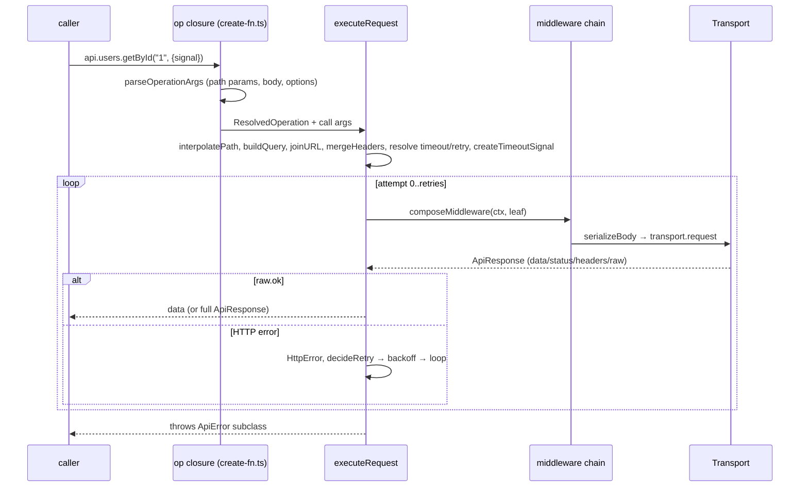

# Apixa — Study Guide

> **Baseline analysed:** the _working tree_ on branch `task/52-customizable-resource-operations` (HEAD `17c45f9`, v0.9.0 shipped) **plus uncommitted v0.10.0 / v0.11.0 work**.
> **Verified on this machine:** `pnpm test` → **29 files / 210 tests pass** (re-run at the end of the analysis; was 27 / 188 at the start); `pnpm typecheck` clean (core, mocking, tanstack-query, tests).
> **Evidence convention:** `file:line` = read directly (line numbers from the working tree at analysis time). `file` + symbol = read, but no line number captured. **[Fact]** = read in code/tests. **[Interpretation]** = my inference. **[Not run]** = derived from reading, never executed.
> **Moving target:** while I was analysing, `packages/core/src/transport/read-body.ts` and `fetch.ts` were edited by something other than me (v0.11.0 item 1 landing). Section I documents the _current_ state and marks what changed.

---

## A. Executive summary

**Apixa** ("Define your API once. Use it everywhere.") is a TypeScript-first monorepo with three publishable packages:

| Package                 | Version in `package.json` | Role                                                                                                                   |
| ----------------------- | ------------------------- | ---------------------------------------------------------------------------------------------------------------------- |
| `@apixa/core`           | `0.1.0`                   | `defineApi()` → typed resource clients over a `Transport` (fetch by default); retry, timeout, middleware, typed errors |
| `@apixa/mocking`        | `0.5.0`                   | Standalone in-memory mock API (`defineMockApi`) + a bridge so Core resources can say `mock: "users-mock"`              |
| `@apixa/tanstack-query` | `0.8.0`                   | `useResourceQuery` hook (React + TanStack Query v5)                                                                    |

**Problem solved:** removing the per-endpoint boilerplate (URL building, request function, response type, error handling) by deriving CRUD operations from `{ path, entity }`.
**Audience:** TypeScript app developers (React/Next/Vue/Angular/RN examples exist) who want a thin typed client, optionally with fixtures and React Query wiring.
**Version drift [Fact]:** git tags/changelog speak of v0.9.0 shipped, v0.10.0 "in working tree, not yet committed" (`versions/README.md`), v0.11.0 planned/in progress — but package versions are `0.1.0 / 0.5.0 / 0.8.0` and nothing in the repo reconciles them (no release tooling found).

**Biggest things to know**

1. Core is _convention-first_: a resource with only `path` gets **16 always-on operations** (`operation/expand.ts:15-50`).
2. Mocking is an **optional peer lazily loaded at first request** (`api/peer-mocking.ts`), but `packages/core/package.json` declares **no** `peerDependencies`/`peerDependenciesMeta` (verified by grep) — the "peer" is documentation-only.
3. Several real defects are code-supported (section L) — and v0.11.0's scope already lists many of them, which corroborates the analysis.

---

## B. Prerequisites and terminology

You need: TypeScript generics/conditional types/`infer`, `fetch`/`Headers`/`AbortSignal`, Promises, pnpm workspaces, Vitest basics; for the TanStack package: React hooks + TanStack Query v5.

| Term                     | Meaning here                                                                                       |
| ------------------------ | -------------------------------------------------------------------------------------------------- |
| **Resource**             | A top-level key of the `defineApi` config whose value has a `path` (`define-api.ts:73-81`)         |
| **Operation**            | A client method on a resource: config object, function, or `false`                                 |
| **Convention / builtin** | A named operation with default method/path (`operation/conventions.ts`)                            |
| **Composed builtin**     | `exists`, `findFirst`, `getMany`, `getBy` — functions over other routes (`operation/builtins.ts`)  |
| **Transport**            | `{ request(TransportRequest): Promise<TransportResponse> }` (`types/transport.ts`)                 |
| **Processor**            | `(configBag) => configBag` hook run before client build (`api/processors.ts`)                      |
| **Dataset**              | JSON fixtures under `datasets/<domain>/<id>/{data,meta}.json`, indexed by `datasets/manifest.json` |
| **Slice**                | `number` or `{start,end}` window over a list                                                       |
| **State generic**        | Zustand-style `defineApi<AppApi>()({...})`: types on `AppApi`, values at runtime                   |

---

## C. Codebase map

```text
apixa/
├─ package.json            root scripts (build/test/typecheck/datasets:build/example:*), pnpm@9.15.0, node>=18
├─ pnpm-workspace.yaml     packages/*, examples/*
├─ tsconfig.json           strict, ES2022, Bundler resolution, noUncheckedIndexedAccess, noEmit
├─ vitest.config.ts        node env; ALIASES every @apixa/* import to package *src* (tests never use dist)
├─ packages/
│  ├─ core/src/            (≈2.5k lines)
│  │  ├─ index.ts          THE public surface (re-exports)
│  │  ├─ api/              define-api, resource-client, processors, peer-mocking
│  │  ├─ operation/        conventions, builtins, expand, resolve, args, create-fn
│  │  ├─ request/          execute (pipeline), retry, middleware, classify-error
│  │  ├─ http/             path, query, headers, body, timeout
│  │  ├─ transport/        fetch, read-body
│  │  ├─ errors/           ApiError + subclasses + guards
│  │  ├─ types/            definition, inference (type-level engine), builtins, extensions, …
│  │  └─ utils/slice.ts    getAll array slicing
│  ├─ mocking/src/         catalog, resource (engine), mock-api, bridge/store/transport (Core bridge),
│  │                       presets/, data/ (typed JSON re-exports), node/load/discover/paths (fs loaders)
│  └─ tanstack-query/src/  use-resource-query, controller, keys, cache, types, advanced
├─ datasets/               15 loadable + 3 excluded fixture sets, manifest.json, ATTRIBUTION.md
├─ tests/                  core/ mocking/ tanstack-query/ examples/ helpers/
├─ docs/                   context, architecture, conventions, roadmap, story, ADRs 001-002, guides/
├─ versions/               frozen per-milestone contracts v0.1.0…v0.11.0
├─ examples/               basic, next (lab app), react-vite, vue, vanilla, angular, react-native — **gitignored** (`.gitignore: examples/**`)
├─ scripts/                run-frontend-*.{sh,bat} launchers; datasets/build-collection.mjs (faker-seeded generator)
└─ .cursor/                agent rules/commands/skill that enforce the docs/versions workflow
```

**Entry points [Fact]:** Core `packages/core/src/index.ts`; mocking `.`, `./register`, `./node`, `./data`, `./data/users-mock` (`packages/mocking/package.json` exports); tanstack `.` and `./advanced`.
**Generated code:** `dist/` (tsup, gitignored but present on disk), `examples/next/.next/`. **Not CI:** no `.github/` directory exists (verified).

```mermaid
flowchart LR
  subgraph Core[@apixa/core]
    api --> operation --> request --> transport
    request --> http & errors
    api -. dynamic import .-> M
  end
  subgraph M[@apixa/mocking]
    register --> processor --> bridge --> store
    mockapi[defineMockApi] --> resource --> catalog --> datasets[(datasets/*.json)]
  end
  TQ[@apixa/tanstack-query] --> Core
  M -->|imports registerDefineApiProcessor, Transport, AbortError| Core
```

Dependency rule (ADR 001): integrations → Core, never Core → integrations. The only reverse edge is the _string-based dynamic import_ `@apixa/mocking/register` (typed by `ambient-mocking-register.d.ts`).

---

## D. Architecture overview

**Style [Interpretation]:** a small convention-driven client generator — config → _expand_ (defaults+overrides) → _resolve_ → per-op closure → shared _pipeline_ → pluggable _transport_. Patterns: Strategy (Transport), Chain of Responsibility (middleware, `request/middleware.ts`), Plugin/Processor seam, Builder-with-defaults (`expandOperations`), Lazy-loading proxy (`createDeferredPeerMockTransport`).

**Design rules** (docs/architecture.md, docs/conventions.md): native Promises; no React/TanStack/caching in Core; custom endpoints win over conventions; don't invent backend routes silently; no production coupling of mocking to request execution.

### Request lifecycle



---

## E. Core concepts and abstractions

1. **`defineApi`** — two overloads (`define-api.ts:90-96`): `defineApi<AppApi>()(config)` (explicit state) and `defineApi(config)` (inferred from literal, `const T`). One runtime impl (`:98-103`).
2. **Operation definition** (`types/definition.ts:21-33`): `{ method?, path?, headers?, timeout?, retry?, hasBody? }`.
3. **Operation function** (`types/builtins.ts:56`): `(ctx, ...args) => Promise<unknown>`; `ctx.request(init)` re-enters the _same_ pipeline.
4. **Type engine** (`types/inference.ts`): derives each method's arity (0/1/2 path params), body, response, query, and `full: true` unwrap (`CallResult`) from `entity`/`list`/`query`/`operations`.
5. **Layered config precedence [Fact]** (`execute.ts`): headers `api < resource < operation < call` (object form: `undefined` deletes a key — `http/headers.ts`); timeout/retry `call > operation > resource > api`.
6. **Processor seam + peer bridge** — how `mock: "<id>"` is handled without Core owning a mock engine.

---

## F. End-to-end execution flows

### F1. `defineApi(config)` → client (`define-api.ts:46-84`)

1. Copy config, run registered processors (`processors.ts:27-33`).
2. If any resource still has `mock`/`mockConfig` ⇒ `applyPeerMockBridge` (strip mock keys, wrap transport in a deferred loader).
3. If still unhandled ⇒ throw.
4. Build `ResolvedApiConfig` (default transport = `createFetchTransport()`).
5. For each non-reserved object-valued key → `createResourceClient(resolved, toHttpResource(value))`.

### F2. Resource client (`resource-client.ts:15-44`)

`expandOperations` → for each op: function ⇒ `createFunctionOperationFn`, object ⇒ `createOperationFn(resolveOperation(...))`. `getAll` is wrapped with `applyResourceSliceToListResult` when `slice` is set (`:33-37`).

### F3. Expand rules (`operation/expand.ts:15-50`)

Order: 5 CRUD → 7 extended declarative → 4 composed; each: `false` ⇒ skip, function ⇒ use it, object ⇒ shallow-copy (override defaults). Then any other names are custom. _Note [Fact]:_ `toHttpResource` copies only `path, operations, headers, timeout, retry, slice` (`define-api.ts:24-44`).

### F4. Executing (see D). Error normalisation: `classifyRequestError` maps timeout-like → `TimeoutError`, abort-like → `AbortError`, otherwise `NetworkError`; `ApiError` instances pass through and get `request` attached.

### F5. `mock: "users-mock"` flow

`defineApi` → (no processor registered) → `applyPeerMockBridge` extracts specs, strips `mock`/`pagination`/seed-`slice` → transport replaced by `createDeferredPeerMockTransport(fallback, specs)` → **first request** dynamically imports `@apixa/mocking/register` (whose side effects register presets + the processor) and calls `createSelectiveMockTransportFromSpecs` → `buildStore` per spec → requests whose `url.pathname` equals/prefixes a store path hit `handleStoreRequest`, everything else goes to `fallback`.

### F6. `defineMockApi` flow

Validate config (`mock-api.ts` `assertConfig`) → `createResource(name, type, opts)` per resource → data loaded **lazily** on first call via the dataset's dynamic `import()` (`catalog.ts`), `structuredClone`d into private state; ids generated only when the dataset's ids are all numeric (`resource.ts` `seed`).

### F7. `useResourceQuery`

`createResourceController` (keys + `queryOptions`/`mutationOptions`) → one `useQuery` (list) + three `useMutation` always mounted; mutations sync cache first (`cache.ts`), then call the consumer's handler (`controller.ts` `createOptions`/…).

---

## G. Complete public API reference

### G1. `@apixa/core` (`packages/core/src/index.ts:1-67`)

| Export                                                                        | Kind    | Purpose / signature                                                                                                                                                                                                                                                                                                                                                                                                                                                                                                                                                                                                                                 | Notes                                                                                                     |
| ----------------------------------------------------------------------------- | ------- | --------------------------------------------------------------------------------------------------------------------------------------------------------------------------------------------------------------------------------------------------------------------------------------------------------------------------------------------------------------------------------------------------------------------------------------------------------------------------------------------------------------------------------------------------------------------------------------------------------------------------------------------------- | --------------------------------------------------------------------------------------------------------- |
| `defineApi`                                                                   | fn      | `defineApi<T extends ApiStateOf<T>>(): (c: ApiInput<T>) => ApiClient<T>` ∣ `defineApi<const T extends ApiRootConfig>(c: T): ApiClient<T>`                                                                                                                                                                                                                                                                                                                                                                                                                                                                                                           | Throws if mock keys remain unhandled (`define-api.ts:53-58`). Resource shape not validated (v0.11 item 5) |
| `registerDefineApiProcessor(p)`                                               | fn      | returns unregister fn                                                                                                                                                                                                                                                                                                                                                                                                                                                                                                                                                                                                                               | Module-global array (`processors.ts:12`)                                                                  |
| `clearDefineApiProcessors()`                                                  | fn      | test helper, but **public**                                                                                                                                                                                                                                                                                                                                                                                                                                                                                                                                                                                                                         |                                                                                                           |
| `setMockingRegisterLoaderForTests(loader?)`                                   | fn      | test hook, **public**                                                                                                                                                                                                                                                                                                                                                                                                                                                                                                                                                                                                                               |                                                                                                           |
| `createFetchTransport(fetchImpl = fetch)`                                     | fn      | `Transport`                                                                                                                                                                                                                                                                                                                                                                                                                                                                                                                                                                                                                                         | Maps DOM abort/timeout → `AbortError`/`TimeoutError`, else `NetworkError`; body via `readBody`            |
| `ApiError`                                                                    | class   | `{status?, code, data?, request?, response?, retryable, attempt?, cause?}`; default code `"NETWORK"`                                                                                                                                                                                                                                                                                                                                                                                                                                                                                                                                                |                                                                                                           |
| `HttpError<D>`                                                                | class   | `code:"HTTP"`, `status` required                                                                                                                                                                                                                                                                                                                                                                                                                                                                                                                                                                                                                    |                                                                                                           |
| `NetworkError`, `TimeoutError`, `AbortError`, `ParseError`, `ValidationError` | classes | `errors/*`                                                                                                                                                                                                                                                                                                                                                                                                                                                                                                                                                                                                                                          | **`ValidationError` is never thrown anywhere** (grep) — dead/reserved                                     |
| `isApiError`, `isHttpError`, `isTimeoutError`                                 | guards  | `instanceof` based (`errors/guards.ts`)                                                                                                                                                                                                                                                                                                                                                                                                                                                                                                                                                                                                             | No `isNetworkError`/`isAbortError`                                                                        |
| Types                                                                         |         | `HttpMethod, PathParams, QueryParams, HeadersInitLike, BuiltinHeaders, RequestConfig, ApiResponse, Transport*, OperationDefinition, RequestOptions, ResponseType, ApiRootConfig, ApiState, ResourceState, OperationState, OperationsBag, ResourceRuntimeInput, QueryArrayFormat, ApiInput, ApiClient, ResourceClient, MockDatasetIds, RetryConfig, ResolvedRetryConfig, RetryHookContext, Middleware*, ResourceExtensions, OperationExtensions, ListOf, QueryOf, CallResult, BuiltinOpName, ExtendedBuiltinOpName, AllBuiltinOpName, OperationFn, OperationFnContext, OperationFnRequestInit, DefineApiProcessor, DefineApiConfigBag, ApiErrorCode` |                                                                                                           |

**Root config** (`ApiRootConfig`, `definition.ts:45-60`): `baseURL` (required), `headers`, `transport`, `timeout` (ms; `0`/undefined = none), `retry`, `middleware[]`, `queryArrayFormat` (`"repeat"` default | `"comma"` | `"brackets"`), `querySerializer(query)=>string` (replaces builder entirely).
**Resource** (`ResourceRuntimeInput`): `path`, `headers`, `timeout`, `retry`, `operations`, plus `slice`, `mock`, `pagination` (`ResourceExtensions`).
**Call options** (`RequestOptions`): `query, headers, signal, timeout, retry, responseType ("json"|"text"|"blob"|"arrayBuffer"|"stream"), meta, full`.
**RetryConfig** (`types/retry.ts`): `retries`, `methods` (default GET/HEAD), `statusCodes` (default 408/429/5xx), `baseDelayMs` 200, `maxDelayMs` 2000, `jitter` true (full jitter), `respectRetryAfter` true, `shouldRetry(ctx)`, `onRetry(ctx)`. `retries` must be finite ≥ 0 else `Error` (`retry.ts` `resolveRetryConfig`).

**The 16 builtins** (`conventions.ts:5-25`, `builtins.ts`):

| Name       | HTTP       | Default path  | Body?                    | Return      | Edge cases                                                                                                                                                  |
| ---------- | ---------- | ------------- | ------------------------ | ----------- | ----------------------------------------------------------------------------------------------------------------------------------------------------------- |
| getAll     | GET        | `""`          | no                       | `ListOf<R>` | `slice` caps array results                                                                                                                                  |
| getById    | GET        | `/:id`        | no                       | entity      |                                                                                                                                                             |
| create     | POST       | `""`          | yes                      | entity      | body type `Omit<E,"id">`                                                                                                                                    |
| update     | PUT        | `/:id`        | yes                      | entity      | `Partial<E>`                                                                                                                                                |
| delete     | DELETE     | `/:id`        | no                       | `void`      | 204 → `null` body                                                                                                                                           |
| getBySlug  | GET        | `/slug/:slug` | no                       | entity      |                                                                                                                                                             |
| patch      | PATCH      | `/:id`        | yes                      | entity      |                                                                                                                                                             |
| upsert     | PUT        | `/:id`        | yes                      | entity      | same wire as update                                                                                                                                         |
| count      | GET        | `/count`      | no                       | number      |                                                                                                                                                             |
| search     | GET        | `/search`     | no                       | `ListOf<R>` |                                                                                                                                                             |
| bulkCreate | POST       | `/bulk`       | yes                      | `E[]`       |                                                                                                                                                             |
| bulkDelete | DELETE     | `/bulk`       | **yes** (`hasBody:true`) | void        |                                                                                                                                                             |
| getMany    | GET        | `""` `?id=…`  | —                        | `E[]`       | composed; wire `id=1&id=2` (verified in `operations-builtins.test.ts:233`). _Docs say `id[]` — doc/behaviour mismatch unless `queryArrayFormat:"brackets"`_ |
| exists     | GET `/:id` | —             | —                        | boolean     | 404→false, others rethrown (`builtins.ts:29-37`)                                                                                                            |
| findFirst  | GET `""`   | —             | —                        | `E \| null` | `Array.isArray(list) ? list[0] ?? null : null` (`:39-42`)                                                                                                   |
| getBy      | GET        | per call      | —                        | entity      | `":x"` placeholder interpolated else value appended (`:16-27`)                                                                                              |

**Minimal example**

```ts
import { defineApi } from "@apixa/core";
const api = defineApi({ baseURL: "https://api.example.com", users: { path: "/users" } });
const user = await api.users.getById("123");
```

**Realistic example**

```ts
type User = { id: string; name: string; email: string };
type AppApi = {
  users: {
    path: "/users";
    entity: User;
    operations: { archive: { method: "POST"; path: "/:id/archive"; response: User } };
  };
};

const api = defineApi<AppApi>()({
  baseURL: "https://api.example.com",
  timeout: 8000,
  retry: { retries: 2 },
  middleware: [
    async (ctx, next) => {
      ctx.request.headers.set("authorization", `Bearer ${await getToken()}`);
      const res = await next();
      if (res.status === 401) {
        await refresh();
        return next();
      } // next() may be called twice
      return res;
    },
  ],
  users: {
    path: "/users",
    operations: {
      delete: false, // remove builtin
      archive: { method: "POST", path: "/:id/archive" },
      byEmail: async (ctx, email: string) =>
        // function op, same pipeline
        ctx.request({ path: "/by-email", query: { email } }),
    },
  },
});
await api.users.archive("1", {}); // arity: 1 path param + body
const { data, headers } = await api.users.getAll({ full: true });
```

**Gotcha (changed in the v0.11 working tree):** `exists`/`findFirst`/`getMany` now delegate to the resource's _resolved_ `getById`/`getAll` (`createComposedBuiltins`, `resource-client.ts`), so overrides are honoured; they fall back to the hard-coded `/:id` / `""` wire shape only if that op was removed with `false`. In the committed v0.9.0 code they hard-coded the shape.

### G2. `@apixa/mocking`

| Export                                                                                  | Purpose                                                                                                                                                                                                                      |
| --------------------------------------------------------------------------------------- | ---------------------------------------------------------------------------------------------------------------------------------------------------------------------------------------------------------------------------- |
| `defineMockApi<const C>(config)`                                                        | `{ users: "users-mock" }` or `{ users: { type, slice?, pagination?, operations? } }`. Validates (`INVALID_CONFIG`, `UNKNOWN_DATASET`, `INVALID_SLICE`). Unsupported keys rejected at runtime _and_ type-level (`ExactInput`) |
| Resource methods                                                                        | `getAll(params?)` (`T[]` or `Page<T>` — never union), `getById`, `create`, `update`, `patch`, `delete`, + 10 extended (`getBySlug, upsert, count, search, bulkCreate, bulkDelete, getMany, exists, findFirst, getBy`)        |
| `MockApiError`/`MockingErrors`/`InvalidSliceError`                                      | `code ∈ INVALID_CONFIG, UNKNOWN_DATASET, NOT_FOUND, DUPLICATE_ID, INVALID_INPUT, INVALID_PAGINATION, INVALID_SLICE`                                                                                                          |
| `registerDatasetPreset / getDatasetPreset / listDatasetPresetIds / clearDatasetPresets` | preset registry used by the **Core bridge**                                                                                                                                                                                  |
| `enableResourceMocks / disableResourceMocks`                                            | register/unregister the processor (idempotent)                                                                                                                                                                               |
| `applyResourceMocksToConfig`, `createSelectiveMockTransportFromSpecs`                   | bridge internals, exported                                                                                                                                                                                                   |
| `./node`: `loadDataset, listDatasets, getDataset, findDatasetDirs, resolveDatasetDir`   | filesystem loaders (`APIXA_DATASETS_DIR` → `./datasets` → repo-relative)                                                                                                                                                     |
| `./data`, `./data/users-mock`                                                           | typed JSON records (side-effectful `users-mock`)                                                                                                                                                                             |

Behaviour **[Fact]** (`resource.ts`): every method returns `structuredClone`s; `create` without id works only for all-numeric-id datasets; `update` replaces but keeps id (different id → `INVALID_INPUT`); `patch` skips `undefined`; `delete` of missing → `NOT_FOUND`; pagination: defaults page 1/size 20, page beyond last → `INVALID_PAGINATION`, empty set = single empty page; `search` = case-insensitive substring on every key given; `getAll(params)` with pagination off → `INVALID_PAGINATION`; unknown op name with `true` → `INVALID_CONFIG`.

### G3. `@apixa/tanstack-query`

`useResourceQuery(resource, { queryKey, scope?, query?, enabled?, staleTime?, gcTime?, refetchOnWindowFocus?, mutations? })` returns list state (`data,isPending,…,query`), imperatives (`getById, create, update(id, body), delete, invalidate, refetch`), `keys`, `mutations.{create,update,delete}` (full `UseMutationResult`s), `controller`.
`/advanced`: `createResourceController`, `createResourceKeys`, `syncCacheAfterCreate/Update/Delete`.
Keys: `[...scope, ...queryKey, "list", query?]`, `[…, "detail", id]`, `[…, "mutation", op]`.
Cache policy **[Fact]** (`cache.ts`): create → seed `detail(id)` + invalidate lists; update → seed detail (or invalidate) + invalidate lists; delete → remove detail + invalidate lists; Apixa sync runs _before_ consumer `onSuccess`. `ResourceLike` still requires only the original 5 ops (`types.ts`); the working tree adds `useResourceMutation` (Appendix V) for the other builtins and custom ops.

### G4. Deprecated / internal-but-exported

`shouldRetry` (`@deprecated` alias, `retry.ts` bottom — not in public index), `ValidateApiConfig` (`@deprecated`, `inference.ts` bottom), `clearDefineApiProcessors`, `setMockingRegisterLoaderForTests` (public test hooks), `MockOperationValue = boolean|fn` (`true` is a documented no-op).

---

## H. Configuration reference

| Where                 | Key                                                                              | Default  | Effect                                                                                                                                                                                                                        |
| --------------------- | -------------------------------------------------------------------------------- | -------- | ----------------------------------------------------------------------------------------------------------------------------------------------------------------------------------------------------------------------------- |
| root                  | `baseURL`                                                                        | required | trailing `/` trimmed (`http/path.ts` `joinURL`); absolute `path` overrides                                                                                                                                                    |
| root/resource/op/call | `headers`                                                                        | —        | merged in order; `Headers`, tuple array, or record; `undefined` deletes (record form only)                                                                                                                                    |
| root/resource/op/call | `timeout`                                                                        | none     | one deadline for the **whole** call incl. retries/backoff (signal created once, `execute.ts`) **[Interpretation from code, not run]**                                                                                         |
| root/resource/op/call | `retry`                                                                          | off      | see G1; `false` disables inherited                                                                                                                                                                                            |
| root                  | `middleware`                                                                     | none     | **per attempt**, left-to-right (`execute.ts` `runMiddlewareAttempt`) — docs/architecture.md says "once around the logical call" ⇒ **doc mismatch**; test `reliability.test.ts` "runs middleware per attempt" agrees with code |
| root                  | `queryArrayFormat`, `querySerializer`                                            | `repeat` | serialiser's `?` is optional (`execute.ts`)                                                                                                                                                                                   |
| resource              | `slice`                                                                          | none     | non-array `getAll` payloads pass through                                                                                                                                                                                      |
| resource              | `mock`, `pagination`                                                             | —        | dataset id; `pagination` only meaningful with `mock` (dropped otherwise)                                                                                                                                                      |
| env                   | `APIXA_DATASETS_DIR`                                                             | —        | Node dataset root (`paths.ts`)                                                                                                                                                                                                |
| build                 | tsup per package, ESM only, `sideEffects` flags                                  |          | mocking marks `register-entry`, `core-augmentation`, `data/users-mock` as side-effectful                                                                                                                                      |
| tooling               | Prettier (`.prettierrc.json`), `engines.node >=18`, `packageManager pnpm@9.15.0` |          | **No ESLint config** despite `eslint-disable` comments in sources                                                                                                                                                             |

---

## I. Internal implementation deep dive

**I1. Type-level arity engine** (`inference.ts`). `FullPath<R,Name,Op>` concatenates resource path + op path; `PathParamName` extracts `:param` names by template-literal recursion; `PathArity` ⇒ 0/1/2 (union detection via `UnionToIntersection`); `BuildOperationFn` picks the call shape: `(options?)`, `(id, options?)`, `(params, options?)`, each ± `body`. `CallResult<Data,O>` yields `ApiResponse<Data>` iff `O extends {full:true}`. Runtime must agree with this: `parseOperationArgs` (`args.ts:4-27`): 1 param → positional, >1 → object, then body (if `hasBody`), then options. **Invariant:** the type-level and runtime derivations of arity/body must stay in sync; `hasBody` for custom DELETE with a body must be set explicitly.

**I2. Operation resolution** (`resolve.ts:7-34`): method from definition or convention; missing ⇒ `Error`; `hasBody` default = convention flag ?? method ∈ {POST,PUT,PATCH}.

**I3. Function operations** (`create-fn.ts:16-48`): `ctx.request` builds a `ResolvedOperation` named `"<custom>"` with `hasBody: body !== undefined`, joins `resourcePath + init.path`, and calls `executeRequest`. Per-op `operation.headers/timeout/retry` do **not** apply (no op config exists), only resource/api + `init`.

**I4. Retry decision** (`retry.ts`): `defaultShouldRetry` → attempt<retries, not `AbortError`, method allowed, then NetworkError/TimeoutError ⇒ true, HttpError ⇒ `isRetryableStatus`. Delay: honour `Retry-After` (seconds or date, **capped to `maxDelayMs`**), else `min(base·2^attempt, max)` with full jitter. `delay()` is abortable.

**I5. Middleware** (`middleware.ts`): index-dispatch compose; `next` re-entrant, so each call re-runs the rest of the chain + one transport hit.

**I6. Timeout/abort** (`http/timeout.ts`): one `AbortController`; external abort propagates `reason`; timer aborts with `DOMException("TimeoutError")`; `cleanup` in `finally`. `timeout: 0` ⇒ treated as "none" (`!timeoutMs`).

**I7. Body handling** (`body.ts`, `read-body.ts`): strings/FormData/URLSearchParams/Blob/ArrayBuffer/views pass through; other values JSON-stringified and `content-type: application/json` set if absent. Response: 204/205 ⇒ `null`; JSON content-type ⇒ text → `parseJson`; `text/*` ⇒ text; unknown ⇒ try JSON else text. **Changed during analysis (uncommitted):** JSON parse failures now throw `ParseError`, and `fetch.ts` no longer swallows body-read errors (previously `body = null` with HTTP 200 success). `git diff -- packages/core/src/transport`.

**I8. Mock engine** (`resource.ts`): lazy `ready` promise with retry-on-failure; id lookup uses a `byId` Map for `getById`/`exists`/`patch`/create-dup-check, linear `findIndex` only for `update`/`delete` (`resource.ts:118-188`); `ctx.rows()` returns the **live** mutable rows by design for custom ops; extended ops are implemented as in-memory functions rather than routes.

**I9. Core mock bridge** (`bridge.ts`/`store.ts`/`transport.ts`): a _separate, smaller_ mock implementation (REST-ish store) from `resource.ts` — two engines with different semantics (see L).

**I10. Invariants worth memorising**

- Reserved keys list is **triplicated** (`define-api.ts:13`, `peer-mocking.ts`, and a _shorter_ one in `mocking/bridge.ts` `RESERVED` with only 4 keys).
- Presets (6) ≠ `MockDatasetIds` (15) ≠ catalog (15) — see L.
- `expandOperations` precedence: explicit override > default; `false` > default; names outside builtins are custom.

---

## J. Examples, basic → advanced

1. **Path-only resource** (A above).
2. **Typed state generic** with `entity` ⇒ `create(body: Omit<User,"id">)`.
3. **Remove + override + add**: `delete:false`, `getById:{path:"/:id/full"}`, custom `archive`.
4. **Reliability**: `retry:{retries:3, shouldRetry, onRetry}`, per-call `signal`, `timeout`.
5. **Middleware with refresh-token replay** (G1 realistic).
6. **Inline mock**: `users:{ path:"/users", mock:"users-mock", slice:50, pagination:true }` — note `pagination` yields a page envelope only through the bridge.
7. **Standalone mock**: `defineMockApi({ products:{ type:"products-mock", slice:50, pagination:true } })` → `await mock.products.getAll({page:2,pageSize:10})`.
8. **React**: `const users = useResourceQuery(api.users, { queryKey:["users"] }); users.create({...}); users.mutations.create.isPending`.
9. **Test transport**: `tests/helpers/fake-transport.ts` + `vitest` alias to src.

Larger working demos exist in `examples/*` (gitignored; **not analysed in depth**, per your scoping).

---

## K. Testing and debugging

**Strategy [Fact]:** behaviour tests against injected fake `Transport`; no network; type-level assertions inside `it()` bodies compiled by `tsc -p tests/tsconfig.json` (so `pnpm typecheck` is part of the safety net, not just `pnpm test`).

| Group                                                                                                          | Verifies                                                                                                                           |
| -------------------------------------------------------------------------------------------------------------- | ---------------------------------------------------------------------------------------------------------------------------------- |
| `tests/core/http`, `config-merge`                                                                              | URL/query/body/header merge, HttpError, NetworkError                                                                               |
| `reliability`                                                                                                  | abort, timeout, retry rules, backoff abort, middleware per attempt / multi-`next()`, op-level `retry:false`                        |
| `default-operations`, `define-api*`, `operations-*`, `resource-client-types`, `v070-thin-core`, `type-markers` | defaults, overrides, `false` removal, function ops, 16 builtins' wire shapes, type surface, removed `type()`                       |
| `define-api-processors`, `define-api-lazy-mocking`, `resource-slice`                                           | processor seam, peer bridge errors, slice                                                                                          |
| `tests/mocking/*`                                                                                              | dataset integrity/manifest, catalog coverage, CRUD, ids, pagination, isolation, concurrency, slice, bridge, operations parity      |
| `tests/tanstack-query/*`                                                                                       | key shapes, cache sync ordering, hook state separation                                                                             |
| `tests/examples/next-api-reliability`                                                                          | the (gitignored) Next example's `lib/api` — **fails on a fresh clone** if `examples/` is absent **[Interpretation; not verified]** |

**Weak/untested [Interpretation, from reading test names]:** `readBody` content-type branches; `serializeBody`/`querySerializer`/`comma` array format; `createTimeoutSignal` external-abort path; `Retry-After` date parsing; `classifyRequestError` DOMException branches; `peer-mocking` edge shapes; bridge query handling; `defineApi` with a resource missing `path`; coverage tooling absent (no `--coverage` configured).

**Debugging recipes:** reproduce with `createFakeTransport`; log `err.request`, `err.attempt`, `err.retryable`; use `onRetry`; for typing issues, hover `ReturnType<typeof api.users.getAll>`.

---

## L. Performance and security considerations; defects

> **Re-verified against the working tree at 29 files / 210 tests passing.** While this guide was being written, v0.11.0 fixes landed in the working tree (`CHANGELOG.md` → _Unreleased / Fixed (v0.11.0)_). Status below is from re-reading the _current_ code. **[Not run]** = derived from reading, not reproduced.

| #   | Finding                                                                                                                                                                                                                                                                                                                  | Status now                                                         | Evidence                                                                                                         |
| --- | ------------------------------------------------------------------------------------------------------------------------------------------------------------------------------------------------------------------------------------------------------------------------------------------------------------------------ | ------------------------------------------------------------------ | ---------------------------------------------------------------------------------------------------------------- |
| 1   | Core `mock:` bridge returned live store records; clone was shallow                                                                                                                                                                                                                                                       | **Fixed (uncommitted)** — `cloneRecords` now `structuredClone`s    | `mocking/src/store.ts:60-61,189,201,274,280`                                                                     |
| 2   | `MockDatasetIds` types 15 ids but only 6 presets are registered for the Core `mock:` path → `mock:"countries-csc"` type-checks, then fails at first request                                                                                                                                                              | **Open [Not run]**                                                 | `types/mock-dataset-ids.ts` (15) vs `presets/builtins.ts` (6 `registerDatasetPreset` calls)                      |
| 3   | `timeout` is one whole-call deadline: signal created once before the retry loop, so a fired timeout aborts the backoff `delay()` immediately; `TimeoutError` is "retryable" by `defaultShouldRetry` yet effectively never recovered. Undocumented                                                                        | **Open [Not run]**                                                 | `execute.ts:62` (`createTimeoutSignal` once), `retry.ts` `delay`/`defaultShouldRetry`                            |
| 4   | `decideRetry` evaluated twice per failed HTTP attempt                                                                                                                                                                                                                                                                    | **Fixed (uncommitted)** — computed once into `shouldRetryThis`     | `execute.ts:~96-104`. _Note:_ the network-error `catch` branch still calls it once per attempt (fine)            |
| 5   | Composed builtins ignored `getById`/`getAll` overrides and broke on paginated envelopes                                                                                                                                                                                                                                  | **Fixed (uncommitted)** — `createComposedBuiltins`, `toArray`      | `operation/builtins.ts`, `api/resource-client.ts`. Fallback to hard-coded `/:id` / `""` only when op set `false` |
| 6   | Resource without string `path` silently produced a broken client                                                                                                                                                                                                                                                         | **Fixed (uncommitted)** — throws naming the resource               | `api/define-api.ts:25-28`                                                                                        |
| 7   | Silent JSON parse failure (`status 200`, `body null`)                                                                                                                                                                                                                                                                    | **Fixed (uncommitted)** — `ParseError`                             | `transport/read-body.ts` `parseJson`, `fetch.ts`, new `tests/core/transport-fetch.test.ts`                       |
| 8   | Bridge `findStore` matched only one path segment → multi-segment routes escaped to the **live** fallback transport                                                                                                                                                                                                       | **Fixed (uncommitted)** — returns `{store, rest}` for any sub-path | `store.ts:133-149`                                                                                               |
| 9   | Bridge matched on `url.pathname` vs `store.path`; a `baseURL` with a path prefix (`https://x.com/v1` + `/users` → `/v1/users`) won't match a store at `/users` and falls through to the real network                                                                                                                     | **Open [Not run]**                                                 | `mocking/src/transport.ts` (`url.pathname`), `store.ts` `findStore`                                              |
| 10  | `docs/architecture.md:60` says middleware runs "once around the logical call (including retries)"; code runs it **per attempt** (`runMiddlewareAttempt` inside the loop; CHANGELOG 0.6.0 says "wrapping the full retry loop")                                                                                            | **Open** — doc/changelog vs code vs test (`reliability.test.ts`)   | `execute.ts` `runMiddlewareAttempt`                                                                              |
| 11  | `docs/conventions.md` says `getMany` uses `id[]`; wire is `id=1&id=2` (default `repeat`)                                                                                                                                                                                                                                 | **Open (doc)**                                                     | `tests/core/operations-builtins.test.ts:233`                                                                     |
| 12  | `@apixa/core` documents "optional peer `@apixa/mocking`" but declares no `peerDependencies`/`peerDependenciesMeta`; package versions `0.1.0 / 0.5.0 / 0.8.0` don't track milestones; `workspace:*` inside `peerDependencies` (tanstack-query) needs a release tool to rewrite **[Interpretation]**                       | **Open**                                                           | `packages/*/package.json`                                                                                        |
| 13  | `ValidationError` is exported but never thrown                                                                                                                                                                                                                                                                           | **Open**                                                           | grep: only `index.ts` + `errors/`                                                                                |
| 14  | **`examples/basic` is stale**: imports removed `createMockTransport`, calls `getByID` (renamed `getById` in #44), loads a nonexistent `users-sample`; `examples/**` is gitignored so nothing catches this. `examples/README.md` still advertises it                                                                      | **Open**                                                           | `examples/basic/src/index.ts`; `CHANGELOG` "Removed: createMockTransport"                                        |
| 15  | `tests/examples/next-api-reliability.test.ts` depends on gitignored `examples/next/lib/api.ts` → breaks on a fresh clone **[Interpretation]**; the Next example's `api.ts` also hits a third-party `mockapi.io` baseURL for the non-mocked `orders` resource and has a syntax-mixed `AppApi` (`;` vs `,`) and `slice: 2` | **Open**                                                           | `examples/next/lib/api.ts`                                                                                       |
| 16  | `readOnly` is **runtime + type** on `ResourceRuntimeInput` but `pagination: "page"\|"cursor"` (type-level, on `ResourceState`) shares a name with `ResourceExtensions.pagination?: boolean` (mock envelope). Two meanings of `pagination` depending on layer                                                             | **Open design smell [Interpretation]**                             | `types/definition.ts` (`"page"\|"cursor"`), `types/extensions.ts:23` (`boolean`)                                 |
| 17  | `useResourceMutation` always invalidates `keys.all()` (whole resource) by default; `ResourceLike` still only requires the original 5 ops                                                                                                                                                                                 | **By design**, but coarse for large lists                          | `tanstack-query/src/use-resource-mutation.ts`, `types.ts`                                                        |
| 18  | Reserved-key list is duplicated three times (`define-api.ts`, `peer-mocking.ts`, shorter 4-key set in `mocking/bridge.ts`)                                                                                                                                                                                               | **Open (maintenance risk)**                                        | the three files                                                                                                  |

**Security**

- No secrets handled by the library; `mergeHeaders` passes whatever you give it. Datasets are scanned for secret-looking fields in `datasets-integrity.test.ts`.
- `encodeURIComponent` on path params and query keys/values (`http/path.ts`, `http/query.ts`) prevents param injection; **but** `joinURL` returns an absolute `path` unchanged (`/^https?:\/\//`), so an operation path — notably `getBy(fieldOrPath, …)` — that comes from user input can bypass `baseURL` and send your headers elsewhere **[Interpretation; not run]**.
- `ApiError.request` carries headers (e.g. `Authorization`) and `response.raw`; don't log errors wholesale.
- Mock engine is dev tooling; keep `mock:` out of production configs (docs/conventions).
- Dataset licensing: ODbL datasets (`countries-csc`, `countries-mledoze`, `cities-capitals`, `states-csc`) carry share-alike obligations (see Appendix T).

**Performance**

- Mock `update`/`delete` remain O(n) (index splice); `getById/exists/patch/create-dup-check` O(1) via `byId` Map (`resource.ts:118-153,238-262`). Every mock read `structuredClone`s whole lists.
- `useResourceQuery` mounts one query + three mutation observers per use and `JSON.stringify`s key segments each render.
- Datasets are dynamic-imported per id (bundler-splittable); three >500 KB sets are intentionally unavailable to `defineMockApi`.

---

## M. Common mistakes and troubleshooting

| Symptom                                                    | Cause                                        | Fix                                            |
| ---------------------------------------------------------- | -------------------------------------------- | ---------------------------------------------- |
| `Missing path parameter: id`                               | wrong arg arity (e.g. object for 1-param op) | follow arity rules (I1)                        |
| `Operation "x" is missing method`                          | custom op without `method`                   | set `method` or use a function op              |
| `Resource mock keys remain unhandled…`                     | `mock` present but bridge failed             | install `@apixa/mocking`; check boolean mock   |
| `Unknown mock dataset`                                     | id not in the 6 presets                      | register a preset or use `defineMockApi` (L-2) |
| Retries never happen on POST                               | default methods GET/HEAD                     | set `retry.methods` (beware idempotency)       |
| Timeout shorter than retries need                          | whole-call deadline                          | size `timeout` for total time                  |
| `getAll` returns object, `slice` ignored                   | slice only caps arrays                       | by design                                      |
| Tests import `dist` and are stale                          | vitest aliases to **src**, apps use **dist** | `pnpm build` before examples                   |
| `exists()` ignores a `getById` override (v0.9.0 code only) | was L-5, fixed in working tree               | upgrade, or override `exists` too              |

---

## N. Extension and contribution guide

**Extension points:** custom `Transport`; `middleware`; `retry.shouldRetry/onRetry`; `querySerializer`; function operations; `registerDefineApiProcessor`; `registerDatasetPreset`; custom `useResourceQuery` mutation handlers; `createResourceController` for non-hook use.
**Workflow (from `docs/conventions.md`, `.cursor/*`):** read `docs/context.md` → active `versions/vX.Y.Z/` (scope, plan, acceptance) → implement smallest path → update `docs/story.md`/CHANGELOG → `/git-push` convention (branch `task/N-slug`, squash merge). No empty future version folders.
**Add an operation safely:**

1. Add name to `BuiltinOpName`/`ExtendedBuiltinOpName` (`types/builtins.ts`).
2. Add default in `conventions.ts` (or a composed fn in `builtins.ts`).
3. Add type shape to `inference.ts` (`EntityBuiltinOps`/`ExtendedBuiltinOps`).
4. Update the error text in `resolve.ts:16-19` and mocking `EXTENDED_MOCK_OPS` (`resource.ts`).
5. Tests: wire shape (core), type surface, mocking parity; docs table in `conventions.md`.
6. Decide bridge behaviour (`store.ts`) — otherwise it 404s.
   **Build/test/release:** `pnpm build` (tsup per package, order core→mocking→tanstack), `pnpm test`, `pnpm typecheck`, `pnpm format`, `pnpm datasets:build` (regenerates faker data with fixed seed 230523). **Release/publish process: Not established from the provided material** (no CI, no changesets, no publish scripts).

---

## O. Alternatives and trade-offs

| Alternative                                                | Trade-off vs Apixa                                                                                                                     |
| ---------------------------------------------------------- | -------------------------------------------------------------------------------------------------------------------------------------- |
| `ky`/`axios`/`ofetch` + hand-written functions             | Mature, but no resource generation or inferred arity                                                                                   |
| `openapi-typescript` + `openapi-fetch`, `orval`, `hey-api` | Contract-first from a spec; stronger for existing backends. Apixa is code-first, OpenAPI is only _planned_ (`docs/architecture.md`)    |
| tRPC / Zodios / ts-rest                                    | End-to-end types with shared server contract; Apixa has no server story yet                                                            |
| TanStack Query alone                                       | Apixa adds a typed client + keys + cache policy on top of it                                                                           |
| MSW / json-server for mocks                                | Real request interception / HTTP semantics; Apixa mocks at the Transport level (no service worker, but mocked paths never hit network) |

Use Apixa for conventional REST + quick prototypes with fixtures. Avoid for: non-REST shapes, runtime schema validation (none), v1-stability needs (pre-1.0, mid-refactor).

---

## P. Study curriculum

Each chapter: **Objectives → Review Qs → Exercises → Debug → Code-reading.**

**Ch1 — Mental model & first client** _(A, B, J1)_
Objectives: run `defineApi`, explain what 16 builtins you got. Qs: What is a reserved key? Why do resources need `path`? Ex: build a client for JSONPlaceholder; remove `delete`. Debug: remove `path` from a resource — what happens, and why (was L-6; the working tree now throws a clear error)? Read: `define-api.ts` end to end.

**Ch2 — Operations engine** _(F2-F3, I2)_
Obj: predict method/path/hasBody for any operation. Qs: precedence of override vs default? what does `false` on an unknown name do? Ex: add `archive`, override `getById` path. Debug: a custom `DELETE` with body sends none — fix with `hasBody`. Read: `expand.ts`, `resolve.ts`, `args.ts`.

**Ch3 — Request pipeline** _(D, I4-I7)_
Obj: trace a failing GET with 2 retries. Qs: where is the signal created? what is `Retry-After` capped by? Ex: write a transport that fails twice then succeeds; assert `attempt`. Debug: explain why a short `timeout` + retry gives `TimeoutError` (L-3) by instrumenting `onRetry`. Read: `execute.ts`.

**Ch4 — Types** _(I1)_
Obj: explain `PathArity`. Qs: why `[undefined] extends [L]` in `ListOf`? Ex: add a `list` override and assert types with `expectTypeOf`-style tests. Debug: an op whose body is `never` — which branch of `HasBody`? Read: `inference.ts` `MergeOp`.

**Ch5 — Errors & middleware** _(G1, I5)_ — Ex: token-refresh middleware; Debug: middleware that forgets `return next()`; Read: `classify-error.ts`.

**Ch6 — Mocking engine** _(G2, I8)_ — Ex: `defineMockApi` with pagination; custom op using `ctx.defaults`. Debug: `create` on `countries-parseapi` fails (non-numeric id). Read: `resource.ts` `seed`/`create`.

**Ch7 — Core↔mocking bridge** _(F5, I9)_ — Ex: write a processor; Debug: reproduce L-2 and L-9 (and report whether they actually occur); Read: `peer-mocking.ts`, `bridge.ts`, `store.ts`.

**Ch8 — TanStack integration** _(G3)_ — Ex: optimistic update via `mutations.update`; Debug: stale list after custom op; Read: `controller.ts`, `cache.ts`.

**Ch9 — Tests & contributing** _(K, N)_ — Ex: add the missing `readBody` tests; Debug: why `tests/examples` can fail on a clean clone; Read: `tests/core/reliability.test.ts`.

**Capstone:** build a "Team Tasks" app: `defineApi<AppApi>()` with `tasks`, `users` (mock `users-mock` locally, live in prod via env switch), auth + refresh middleware, `retry` on GET only, custom `tasks.archive`, `useResourceQuery` list with optimistic toggle, tests with fake transport covering retry, abort, 404 `exists`, and a regression test for one defect from section L (fix it upstream if you can).

---

## Q. Glossary

Bag · Builtin · Composed op · Convention · Dataset/preset · Envelope (`Page`) · Peer bridge · Processor · Resolved config · Slice · State generic · Transport · Wire shape.

---

## Appendix S. Version history, migrations and roadmap

**Source:** `CHANGELOG.md`, `versions/v0.1.0–v0.11.0/scope.md` (read), `docs/roadmap.md`, `docs/context.md`.

| Version              | Theme                                                                                                                                                 | Breaking / notable                                                                                                                                                                                                          |
| -------------------- | ----------------------------------------------------------------------------------------------------------------------------------------------------- | --------------------------------------------------------------------------------------------------------------------------------------------------------------------------------------------------------------------------- |
| 0.1.0                | `defineApi`, opt-in operations, Fetch transport, `ApiError`/`HttpError`/`NetworkError`, `examples/basic`                                              | Replaced `createApi`                                                                                                                                                                                                        |
| 0.2.0                | **Default-first**: path-only resource gets 5 CRUD ops; `operations` = partial overrides                                                               | Precedence: api → resource → builtin defaults → op → call                                                                                                                                                                   |
| 0.3.0                | `type<T>()` branded markers                                                                                                                           | **Removed in 0.4.0**                                                                                                                                                                                                        |
| 0.4.0                | Zustand-style `defineApi<AppApi>()({…})`, `entity` → derived `create`/`update`; `BuiltinHeaders`                                                      | `type()`/`Type`/`Infer` gone (test `type-markers.test.ts`)                                                                                                                                                                  |
| 0.5.0                | `@apixa/mocking`, local JSON datasets + manifest, FastAPI backend removed                                                                             | `createMockTransport` (later removed)                                                                                                                                                                                       |
| post-0.5             | `defineMockApi`, `MockApiError`, `./register`, lazy optional peer                                                                                     | Removed `createMockTransport`, public `createSelectiveMockTransport`, required side-effect import                                                                                                                           |
| 0.6.0                | `signal`/`timeout`, opt-in `retry`, thin `middleware`                                                                                                 | —                                                                                                                                                                                                                           |
| 0.7.0                | Thin Core + plugin seams; `queryArrayFormat`/`querySerializer`; `full`; `responseType`; retry hooks                                                   | **Breaking:** middleware `next()` returns `ApiResponse` & re-callable; mock keys left Core types (then re-added via `ResourceExtensions` + Core-owned `MockDatasetIds` in 0.9); `hasBody` by method; error codes → `NETWORK | HTTP | PARSE | VALIDATION | TIMEOUT | ABORT` |
| 0.8.0                | `@apixa/tanstack-query` `useResourceQuery`                                                                                                            | `getByID` → `getById` rename shipped via #44 between 0.7 and 0.8                                                                                                                                                            |
| 0.9.0                | `mock: "<dataset-id>"` flat syntax; `pagination` sibling of `path`                                                                                    | **Breaking:** removed `mock: true/false`, `mockConfig`                                                                                                                                                                      |
| 0.10.0 (uncommitted) | `operations` = object ∣ function ∣ `false`; 11 always-on builtins; mock parity                                                                        | Superseded as "current" before commit                                                                                                                                                                                       |
| 0.11.0 (in progress) | Hardening + `pagination: "page"∣"cursor"` (type-only), `readOnly`, `useResourceMutation`, bridge `operations` + 5 simulated routes, O(1) mock lookups | See Appendix V                                                                                                                                                                                                              |

**Migration recipes (from CHANGELOG 0.7/0.9):** middleware must `return next()`; replace `error.code === "NETWORK_ERROR"` with `"NETWORK"`; custom POST without body needs `hasBody:false`; `mock: true, mockConfig:{type}` → `mock:"<id>"`; `getByID` → `getById`.

**Roadmap (docs/roadmap.md):** after 0.11.0 → v1.0.0 "usable". Later: schema-validation hooks, request dedupe in tanstack package, dataset catalog codegen, browser/server packages with server-only secrets, deeper TanStack (infinite/optimistic), OpenAPI import/export, versioning, observability, CLI/codegen, plugins. `docs/context.md` principle 9: _a resource definition must not imply every conventional endpoint exists on the backend_ — which sits in tension with 16 always-on builtins (docs/conventions.md answers: calling an unimplemented route simply 404s).

**Project meta:** MIT, author Abdalrahman bani younes (`docs/context.md`); work is issue→`task/N-slug` branch→squash PR (`.cursor/commands`, `apixa-git-push-format.mdc`); `docs/story.md` is a milestone log; 25 commits in history.

## Appendix T. Datasets (`datasets/`, `scripts/datasets/`)

- Layout: `datasets/<domain>/<id>/{data.json,meta.json}` + `manifest.json` (`version 1.0.0`, `seed 230523`, `generators`, `datasets[]`, `skipped[]`) + `ATTRIBUTION.md`. `meta.json` shape validated by `mocking/src/load.ts` `assertMeta` (id, title, license, version, `resource.path`, `schema.fields`).
- 18 sets on disk, 15 exposed to `defineMockApi`/`MockDatasetIds`:

| Origin                        | IDs (records)                                                                                                                      | License                                     |
| ----------------------------- | ---------------------------------------------------------------------------------------------------------------------------------- | ------------------------------------------- |
| Generated (Faker, seeded)     | users-mock 100, products-mock 100, companies-mock 40, orders-mock 80, posts-mock 100, comments-mock 100, country-codes-iso 250     | MIT                                         |
| Imported CC0 (parseapi/lists) | countries-parseapi 250, currencies 156, languages 224, timezones 418, area-codes 424, states-parseapi 5308, counties-parseapi 3572 | CC0-1.0                                     |
| Imported ODbL                 | countries-csc 250, countries-mledoze 250, cities-capitals 245, states-csc 5328                                                     | **ODbL-1.0 share-alike** (`ATTRIBUTION.md`) |
| Excluded from mocking catalog | `states-csc`, `states-parseapi`, `counties-parseapi` (>500 KB; parseapi sets have non-unique ids)                                  | —                                           |

- `manifest.skipped` records 10 sources deliberately not redistributed (DummyJSON responses, `datasets/country-codes`, catalog pages, unused generators `falso`/`json-schema-faker`/`chance`) with reasons — the repo substitutes **original synthetic** sets for the unlicensed ones.
- `build-collection.mjs` (715 lines): downloads into gitignored `scripts/datasets/.cache/`, writes dataset folders, regenerates synthetics with Faker seed 230523, rewrites manifest + attribution. Needs network on first run; `pnpm datasets:build`.
- Tests: `datasets-manifest` (provenance fields, file counts, skipped/substituted), `datasets-integrity` (every dataset parses, no secret-looking fields, FK integrity for relational synthetic sets, nested-path vs short-id load), `mock-api-data` (catalog ⊆ manifest, documented exclusions).
- **Risk [Interpretation]:** a library that bundles ODbL data into an MIT package — consumers of `countries-csc` etc. inherit share-alike obligations; the data is imported statically (`catalog.ts` JSON imports), so it may end up in app bundles.

## Appendix U. Scripts, tooling and examples

**Scripts (`scripts/`):** 21 thin launchers (`macos|linux|win` × `angular|basic|next|react|react-native|vanilla|vue`) → `scripts/lib/run-frontend.{sh,bat}`, which check for `pnpm`, build `@apixa/core` and `@apixa/mocking`, then run `pnpm --filter <example> <script>`. **Gap [Fact]:** the helper does **not** build `@apixa/tanstack-query`, but the Next example depends on it (root `example:next` script does build it) — running `run-frontend-next.sh` on a clean checkout may fail to resolve `dist` **[Not run]**.

**Tooling files:** `.prettierrc.json`/`.prettierignore` (only formatter; Prettier re-formats `docs/` — it reformatted this guide while I worked), `.vscode/settings.json` (gitignored via `/.vscode` but tracked), `.gitignore` ignores `examples/**`, `dist`, `*.tsbuildinfo`, `.env*`. No ESLint, no CI, no changesets, no pre-commit hooks.

**Cursor agent workflow:** `.cursor/rules/apixa-*.mdc` (core, docs, examples, packages, git-push-format) + `.cursor/commands/{plan-change,implement-version,start-version,check-structure,git-push}.md` + skill `apixa-workflow`. These encode: read `docs/context.md` → active `versions/` → implement → update `docs/story.md`; "only `examples/next` is maintained" (`apixa-core.mdc`).

**Examples (`examples/`, gitignored; skimmed):**

| Example                                                             | Stack                                          | Notes                                                                                                                                                                                                                                                              |
| ------------------------------------------------------------------- | ---------------------------------------------- | ------------------------------------------------------------------------------------------------------------------------------------------------------------------------------------------------------------------------------------------------------------------ |
| `next`                                                              | Next 15 + React 19 + core + mocking + tanstack | **Primary.** `lib/api.ts` (below), `/test/*` lab with 15 pages (requests, errors, reliability, middleware, mocking, cache, queries, mutations, data, report, capstone), `app/api/lab/[...slug]/route.ts` (354 lines test backend), `lib/test-guide.ts` (703 lines) |
| `react-vite`                                                        | Vite 6 + React 19 + core                       | not maintained per rule                                                                                                                                                                                                                                            |
| `vue`, `vanilla`, `angular` (19), `react-native` (Expo 52, RN 0.76) | core only                                      | not maintained per rule                                                                                                                                                                                                                                            |
| `basic`                                                             | Node CLI via tsx                               | **Stale** (L-14)                                                                                                                                                                                                                                                   |

`examples/next/lib/api.ts` shows the real-world style: `export interface AppApi` (an **interface** — which is why `defineApi<T extends Record<…>>` was too strict and `ApiStateOf<T>` was added), `middleware: [playgroundMiddleware]`, `users` with `mock:"users-mock"`, `slice:100`, function operation `archive`, plus `defineMockApi({ users, comments:{pagination:true} })`.

## Appendix V. What the v0.11.0 working tree adds (as of this re-verification)

**`@apixa/core`**

- `ApiStateOf<T> = { [K in keyof T]: ResourceState }` and `defineApi<T extends ApiStateOf<T>>()` — state may be an `interface` (test: `tests/core/define-api-state.test.ts` "accepts interfaces"). Limitation: a named-interface `operations` bag still fails `OperationsBag`'s `Record<string,V>` **[Interpretation]**.
- `ResourceState.pagination?: "page" | "cursor"` (type-only; `getAll` typed as `{data,total,page,pageSize}` / `{data,nextCursor}`) and `readOnly?: boolean` (runtime: `expandOperations(ops, {readOnly})` strips `create, update, patch, upsert, delete, bulkCreate, bulkDelete`; explicit `operations` entry wins). `define-api.ts:50-51` copies `readOnly` through.
- `createComposedBuiltins({getById,getAll})` + resource-client two-phase build: non-composed ops first, composed ops after; `isUnoverriddenDefault = definition === COMPOSED_BUILTINS[name]` decides delegation vs the developer's own function (`resource-client.ts`). `toArray()` accepts bare arrays or `{data:[]}`.
- `ParseError` is now thrown for malformed JSON declared `application/json` (message includes a 200-char preview, `cause` kept).

**`@apixa/mocking`**: bridge `operations` + `extendedRoutes` (`getBySlug`, `count`, `search`, `bulkCreate`, `bulkDelete` static routes, matched by `matchRouteTemplate`), `findStore` returns `{store, rest}`, `structuredClone` on all store reads, `byId: Map` in `resource.ts` (`getById`/`exists`/`patch`/`create` duplicate check O(1); `update`/`delete` O(n)).
**Still 404 on the bridge:** genuinely custom function operations (documented honest limitation) and `getMany`/`getBy` rely on the generic routes.

**`@apixa/tanstack-query`**: `useResourceMutation(resource, opName, {queryKey, scope?, invalidate=true, onMutate, onSuccess, onError, onSettled, retry, meta})` → `UseMutationResult<Awaited<ReturnType<R[Name]>>, Error, Parameters<R[Name]>>`; variables are the **argument tuple** (e.g. `mutateAsync([id, {name}])`). mutationKey `[...keys.all(), "mutation", name]`; invalidates `keys.all()` _then_ calls consumer `onSuccess`. Tests: `tests/tanstack-query/use-resource-mutation.test.tsx` (3).

**New/changed tests:** `transport-fetch.test.ts` (ParseError path), expanded `reliability`, `operations-customization` (mocking), `define-api-state` (interfaces). **One thing I noticed earlier and could not re-check:** `tests/mocking/operations-customization.test.ts:244` briefly failed typecheck/assert mid-edit, but the final run is green (210/210).

---

## R. Open questions / not established

- Release/publish pipeline, CI, lint rules, and the mapping from package versions (`0.1.0/0.5.0/0.8.0`) to milestones: **Not established from the provided material.**
- Findings marked **[Not run]** (L-2, L-3, L-9, L-15, Appendix U gap) are derived from reading, not reproduced.
- v0.11.0 is still moving; items L-1,4–8 were observed _landing_ during the analysis, uncommitted. Re-diff before relying on file/line numbers.
- Not read in full: `examples/next/app/test/**` page bodies, `test-guide.ts`, `app/api/lab` route, Vue/Angular/RN example sources; `mocking/src/data/*` (typed entity re-exports); per-dataset `meta.json`/`data.json` contents (only manifest + integrity tests); `docs/external-context.md`, `docs/story.md` body, `docs/guides/**`, `versions/v0.1–v0.10/{context,implementation-plan,acceptance-criteria}.md` (scopes only); `structure.txt`, `pnpm-lock.yaml`.

### File & topic checklist

| Area                                                        | Status                                                                                                                            |
| ----------------------------------------------------------- | --------------------------------------------------------------------------------------------------------------------------------- |
| `packages/core/src/**` (all 40+ files)                      | ✅ read in full, re-checked after v0.11 edits (`builtins`, `resource-client`, `execute`, `define-api`, `read-body`, `definition`) |
| `packages/mocking/src/**`                                   | ✅ all but `data/*`; `store.ts`, `bridge.ts`, `resource.ts` re-read post-edit                                                     |
| `packages/tanstack-query/src/**`                            | ✅ all incl. new `use-resource-mutation.ts`                                                                                       |
| Configs (root/package/tsconfig/vitest)                      | ✅                                                                                                                                |
| `tests/**`                                                  | ◐ all case names + run results (29 files/210 tests); bodies read for several files, not every assertion                           |
| `docs/` (architecture, conventions, context, roadmap, ADRs) | ✅ · `story`, `external-context`, `guides/**`: ❌                                                                                 |
| `CHANGELOG.md`, `versions/`                                 | ✅ CHANGELOG (top 0.11→0.5, headings below) · scopes v0.1–v0.11 (partial for 0.3–0.7) · other version files ❌                    |
| `datasets/` + `scripts/datasets`                            | ◐ manifest, attribution, build script head, tests · record files ❌                                                               |
| `scripts/` launchers                                        | ✅ README + shared helper · per-OS wrappers assumed identical (✗ not each opened)                                                 |
| `examples/`                                                 | ◐ package manifests, READMEs, `basic`, `next/lib/api.ts`, tree listing · lab pages ❌                                             |
| `.cursor/`, `.vscode`, `.gitignore`                         | ◐ core rule + names of commands · rest ❌                                                                                         |
